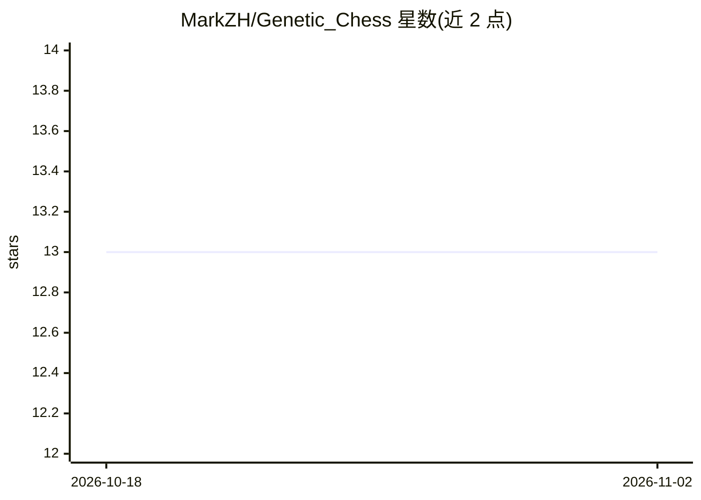

# MarkZH/Genetic_Chess

⭐ 13 · C++ · MIT · 推送 2026-07-17 · [GitHub](https://github.com/MarkZH/Genetic_Chess) · 个人维护

**用遗传算法进化出会下棋的 AI 的 C++ 程序**

C++ 编写的国际象棋引擎，通过基因池机制培育棋力：让候选 AI 互相对弈，胜者产生变异副本进入下一代，经过数万代进化后可得到棋子价值排序正确的基因组。支持通过 cutechess 等棋类 GUI 以引擎方式对弈，也支持运行基因池自行进化，并提供 Python 脚本生成进化过程图表。Linux 需 gcc/clang 编译，Windows 用 Visual Studio 编译。作者自述为业余尝试（amateur attempt）。

## 筛选速览

| 维度 | 判定 | 备注 |
|---|---|---|
| AI 角色 | `ai-native` | 本体是模型或模型工具 |
| 许可风险 | `permissive` | MIT |
| 部署形态 | `None` |  |
| 模型依赖 | — | README 未给出锁定关系 |
| 硬件要求 | — | 无带数字的原话,不猜 |
| 安装摩擦 | `low` | 无编译、无系统依赖或容器化 |
| 成熟度 | — | 结构信号不足 |

## 能力要点

- 基因池进化：对弈胜者的变异副本进入下一代
- 进化数万代后得到棋子价值排序与相对价值
- 可接入 cutechess 等 GUI 作为 UCI 类引擎对弈
- Python 脚本生成进化与行为分析图表（需 numpy/matplotlib）

## 适用场景

- 观察遗传算法能否进化出合理的棋子价值评估
- 运行基因池自行培育棋类 AI 并绘制进化图表
- 把进化出的引擎接入棋类 GUI 对弈

## 场景标签

 · 领域:进化计算/棋类 AI

## 证据(README 行号)

> L3: An amateur attempt at breeding a chess-playing AI.
> L5: This program attempts to create a chess-playing AI by playing prospective AIs
> L6: against each and letting the winners produce mutated copies. As evidence that

## 星数曲线

2026-10-18 13 → 2026-11-02 13（+0）

---
*卡片 v1 · prompt 1.4 · 生成 2026-10-31 · 置信度 high · 依据 README sha `98015a5985c2` · [字段定义](../../DATASET.md)*
