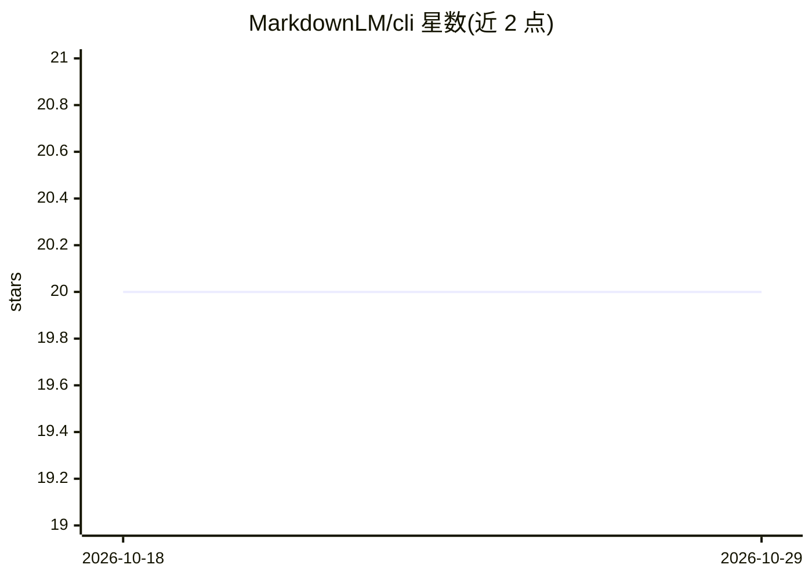

# MarkdownLM/cli

⭐ 20 · Python · NOASSERTION · 推送 2026-02-24 · [GitHub](https://github.com/MarkdownLM/cli) · [官网](https://pypi.org/project/mdlm/) · 组织维护

**MarkdownLM 知识库治理 CLI：文档同步、规则查询与代码校验**

面向使用 MarkdownLM 知识库团队的命令行工具，通过 API key 连接服务端，提供类 git 的文档工作流：clone 拉取全部文档到本地、pull/push 同步（含冲突检测与删除保护）、status 查看变更；并可按类别查询团队规则/设计模式、将代码对照规则校验（validate）、补齐文档缺口（resolve-gap）。API key 以 0600 权限存储，强制 HTTPS。需 Python 3.8+ 与 requests，从源码 pip 安装。

## 筛选速览

| 维度 | 判定 | 备注 |
|---|---|---|
| AI 角色 | `ai-ecosystem` | LLM/agent 周边工具 |
| 许可风险 | `none` | NOASSERTION |
| 部署形态 | `library` | 以包/库形式分发 |
| 模型依赖 | — | README 未给出锁定关系 |
| 硬件要求 | — | 无带数字的原话,不猜 |
| 安装摩擦 | `low` | 无编译、无系统依赖或容器化 |
| 成熟度 | — | 结构信号不足 |

## 能力要点

- 类 git 的文档同步命令：clone/pull/push/status，push 前做远程版本冲突检测
- query/validate/resolve-gap 支持按类别查询规则、校验代码、补文档缺口
- 安全机制：API key 0600 权限存储、getpass 输入、强制 HTTPS、删除需显式 --delete

## 适用场景

- 把团队知识库文档拉到本地并以 git 式工作流同步维护
- 提交代码前对照知识库中的架构规则做校验
- 查询团队既定设计模式并补齐文档缺口

## 场景标签

`知识库管理` `代码审查` · 领域:编码与开发

## 证据(README 行号)

> L3: **mdlm** is a governance-focused CLI tool for your markdownlm knowledge base. It bridges the gap between your codeba
> L34: |`mdlm query Q [-c CAT]`|Query rules/patterns (def: `general`)|
> L35: |`mdlm validate CODE -t TASK [-c CAT]`|Check code vs rules|

## 星数曲线

2026-10-18 20 → 2026-10-29 20（+0）

---
*卡片 v1 · prompt 1.4 · 生成 2026-10-28 · 置信度 low · 依据 README sha `52efb7554da6` · [字段定义](../../DATASET.md)*
