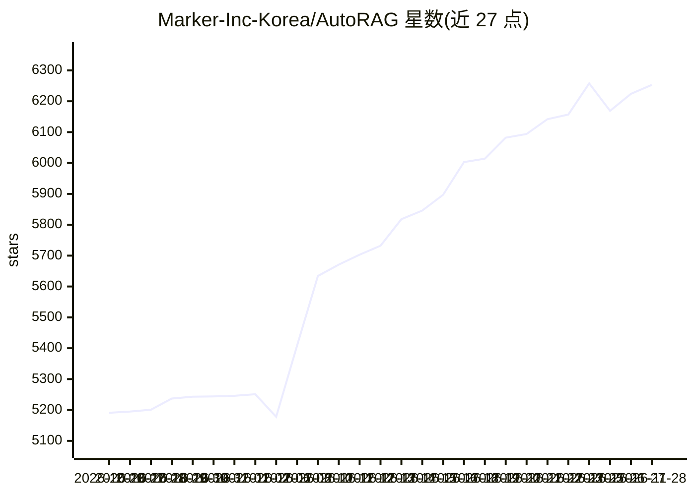

# Marker-Inc-Korea/AutoRAG

⭐ 6,253 · TypeScript · Apache-2.0 · 推送 2026-11-27 · [GitHub](https://github.com/Marker-Inc-Korea/AutoRAG) · 组织维护

**个人图书馆员 Agent：检索、阅读并引用本机文件**

AutoRAG 2.0 定位为个人图书馆员 Agent：对本地文件做混合关键词+语义检索并经重排序，回答中每条论断附带出处引用；可接入 Slack、KakaoTalk、Telegram、GitHub、Obsidian 等数据源与既往编码 agent 会话。提供 Dazzi 桌面应用、TUI、CLI、MCP server、TypeScript API 等多种使用面，支持 macOS/Linux/Windows。语义索引用 MinSync 本地 Qwen3-Embedding-0.6B；旧版 RAG AutoML 工具移入 legacy/ 目录并处于维护模式。

## 筛选速览

| 维度 | 判定 | 备注 |
|---|---|---|
| AI 角色 | `ai-native` | 本体是模型或模型工具 |
| 许可风险 | `permissive` | Apache-2.0 |
| 部署形态 | `library` | 以包/库形式分发 |
| 模型依赖 | — | README 未给出锁定关系 |
| 硬件要求 | — | 无带数字的原话,不猜 |
| 安装摩擦 | `low` | 无编译、无系统依赖或容器化 |
| 成熟度 | — | 结构信号不足 |

## 能力要点

- 混合关键词+语义检索加重排序，回答附引用出处
- 本地 Qwen3-Embedding-0.6B 嵌入索引，文件内容默认不出本机
- 同一引擎覆盖桌面应用/TUI/CLI/MCP server/TypeScript API 多种形态
- 文件版本堆叠（Latest/Similar/Exact）与 Quick Look 预览

## 适用场景

- 在桌面应用中用自然语言提问并核对引用出处
- 通过 MCP server 给编码 agent 提供本机文件检索
- 按触发规则让 agent 自动整理新文件

## 场景标签

`知识库管理` `文档问答` · 领域:知识与检索

## 证据(README 行号)

> L5: **Your personal librarian agent: it finds, reads, and cites anything on your computer.**
> L23: - **Fast file search.** Hybrid keyword + meaning search with a reranker finds files by what is inside them, and eve
> L86: - **Embedded on your machine.** Semantic indexing runs on MinSync's local

## 星数曲线

2026-10-26 5,191 → 2026-11-28 6,253（+1,062）

---
*卡片 v1 · prompt 1.4 · 生成 2026-11-28 · 置信度 high · 依据 README sha `4a502bb97077` · [字段定义](../../DATASET.md)*
