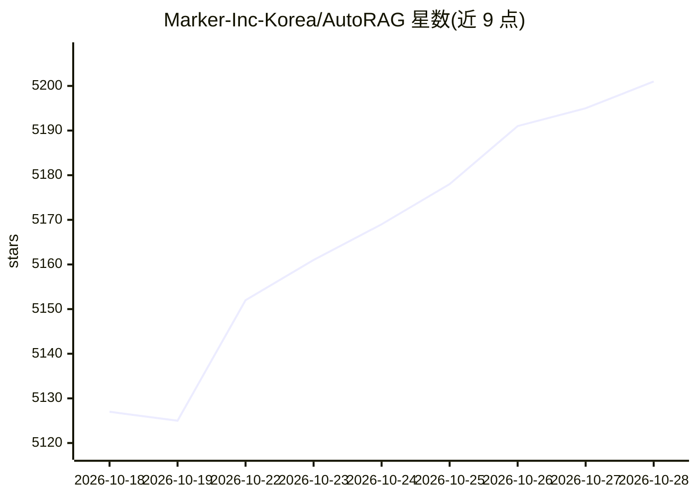

# Marker-Inc-Korea/AutoRAG

⭐ 5,201 · TypeScript · Apache-2.0 · 推送 2026-10-27 · [GitHub](https://github.com/Marker-Inc-Korea/AutoRAG) · 组织维护 · 中文 README

**本地自进化图书管理员 agent：跨文件与聊天数据检索并生成带引用答案**

AutoRAG 2.0 是一个自进化的图书管理员 agent，基于 Pi agent 框架，用单一配置模型跨 BM25、向量、混合检索与数据源联邦（Slack/KakaoTalk/Discord/Telegram/WhatsApp/邮件/GitHub/Obsidian）就地检索本地数据，通过 bash 直接读取文件核实事实，产出带编号引用的知识单元，并将引用证据存入检索记忆供后续查询参考。原 Python 版 RAG AutoML 工具移入 legacy/ 目录以维护模式继续发布。同一引擎可通过桌面应用 Dazzi（独立 Fair Source 仓库）、TUI、CLI、MCP server 与 TypeScript API 使用。文档理解使用本地 qwen3-embedding-0.6b 模型，文件内容不发送到远程 embedder。

## 筛选速览

| 维度 | 判定 | 备注 |
|---|---|---|
| AI 角色 | `ai-native` | 本体是模型或模型工具 |
| 许可风险 | `permissive` | Apache-2.0 |
| 部署形态 | `library` | 以包/库形式分发 |
| 模型依赖 | — | README 未给出锁定关系 |
| 硬件要求 | — | 无带数字的原话,不猜 |
| 安装摩擦 | `low` | 无编译、无系统依赖或容器化 |
| 成熟度 | — | 结构信号不足 |

## 能力要点

- 数据就地联邦检索，无需迁移到集中式向量库
- BM25/向量/混合多路检索 + RRF 融合，结果去重归一
- agent 直接用 bash 读取文件核实事实，答案带编号引用
- 引用证据存入 ~/.autorag/memory.json 作为后续检索的参考记忆

## 适用场景

- 在本地文件、聊天记录和邮件中直接提问并获得带出处的答案
- 通过 MCP server 为 Claude Code 等编码 agent 提供检索能力
- 在 Telegram/Discord/WhatsApp 中向图书管理员提问

## 场景标签

`RAG` `文档问答` · 领域:知识与检索

## 证据(README 行号)

> L25: folders as usual, then ask a question and get an answer that cites the files,

## 星数曲线

2026-10-18 5,127 → 2026-10-28 5,201（+74）

---
*卡片 v1 · prompt 1.4 · 生成 2026-10-20 · 置信度 mid · 依据 README sha `90fd445fed0c` · [字段定义](../../DATASET.md)*
