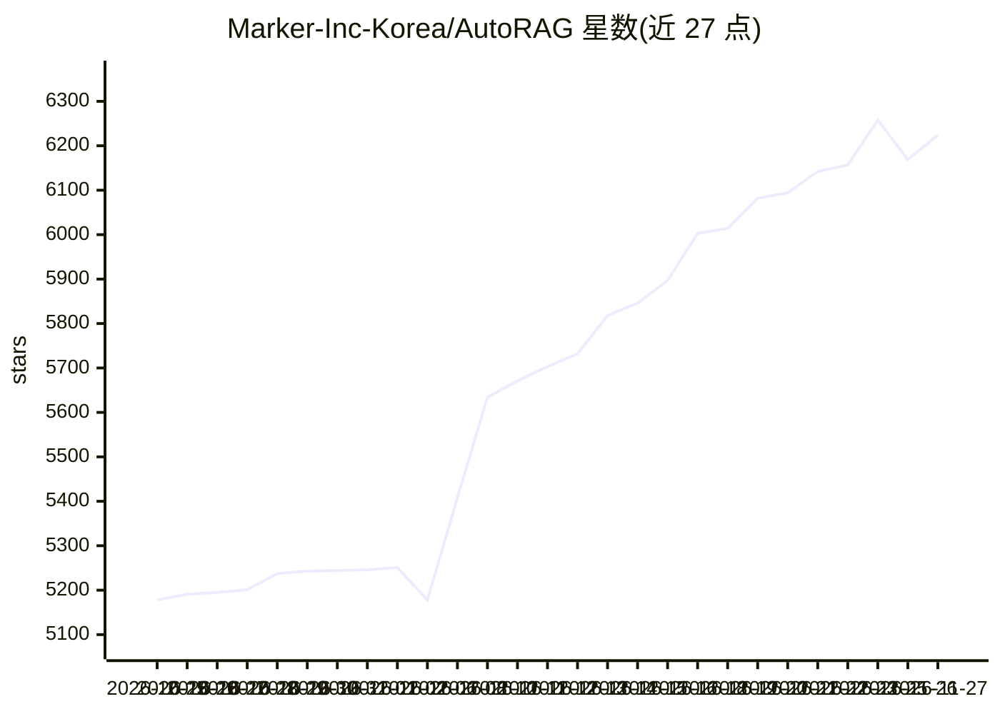

# Marker-Inc-Korea/AutoRAG

⭐ 6,224 · TypeScript · Apache-2.0 · 推送 2026-11-26 · [GitHub](https://github.com/Marker-Inc-Korea/AutoRAG) · 组织维护

**本地优先的个人图书管理员 agent：检索并引用电脑上的文件**

AutoRAG 2.0 定位为个人图书管理员 agent，对本地文件与多个数据源（Slack、Telegram、Notion、GitHub、网盘同步目录等）做混合关键词+语义检索并重排，回答附带原文引用；支持重复文件检测、文件预览（含 HWP 本地渲染）、文件夹自动化、远程访问与多语言界面。同一引擎提供桌面应用 Dazzi、TUI、CLI、MCP server、TypeScript API 等多种入口；语义索引用本地 Qwen3-Embedding-0.6B，文件内容默认不外发。原 Python RAG AutoML 工具移入 legacy/ 目录，仅维护模式。

## 筛选速览

| 维度 | 判定 | 备注 |
|---|---|---|
| AI 角色 | `ai-native` | 本体是模型或模型工具 |
| 许可风险 | `permissive` | Apache-2.0 |
| 部署形态 | `library` | 以包/库形式分发 |
| 模型依赖 | — | README 未给出锁定关系 |
| 硬件要求 | — | 无带数字的原话,不猜 |
| 安装摩擦 | `low` | 无编译、无系统依赖或容器化 |
| 成熟度 | — | 结构信号不足 |

## 能力要点

- 混合关键词+语义检索带重排，回答附原文引用
- 本地嵌入引擎 Qwen3-Embedding-0.6B，数据不出机
- 桌面应用 Dazzi、TUI、CLI、MCP server、TypeScript API 多入口
- 连接 Slack/Telegram/Notion/GitHub/网盘等数据源联合搜索

## 适用场景

- 在电脑上用自然语言提问并定位带引用的文件
- 整理重复文件并按规则自动分类新文件
- 通过 MCP 把本地文件检索接入编码 agent

## 场景标签

`知识库管理` `文档问答` · 领域:知识与检索

## 证据(README 行号)

> L5: **Your personal librarian agent: it finds, reads, and cites anything on your computer.**
> L33: > This repository now hosts **AutoRAG 2.0**, a complete reimagining of AutoRAG as a personal librarian agent for yo
> L85: - **Embedded on your machine.** Semantic indexing runs on MinSync's local

## 星数曲线

2026-10-25 5,178 → 2026-11-27 6,224（+1,046）

---
*卡片 v1 · prompt 1.4 · 生成 2026-11-26 · 置信度 mid · 依据 README sha `4e5e2741864b` · [字段定义](../../DATASET.md)*
