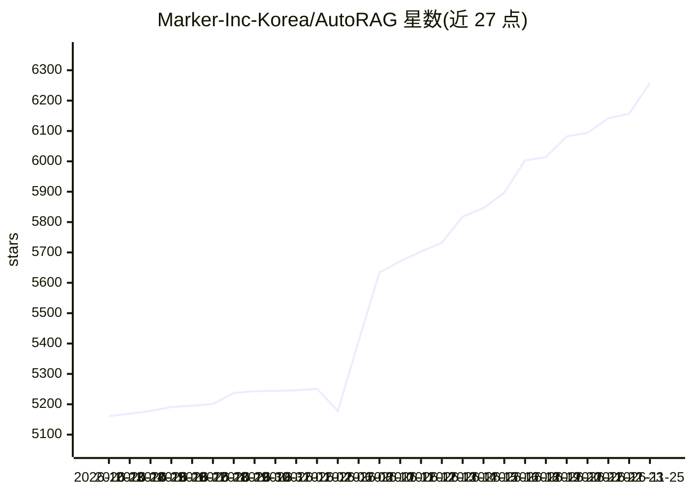

# Marker-Inc-Korea/AutoRAG

⭐ 6,258 · TypeScript · Apache-2.0 · 推送 2026-11-23 · [GitHub](https://github.com/Marker-Inc-Korea/AutoRAG) · 组织维护

**本地优先的个人图书馆员 Agent：检索并引用你电脑上的文件**

AutoRAG 2.0 将原 RAG AutoML 工具重构为个人图书馆员 Agent：以混合关键词+语义搜索配合 reranker 在本地文件中查找内容，回答附带原文出处引用，并可索引 Slack、KakaoTalk、Telegram、GitHub、Obsidian 等消息与数据源。语义索引由 MinSync 在本机运行 Qwen3-Embedding-0.6B 完成。提供桌面应用 Dazzi、TUI、CLI、MCP server 与 TypeScript API 多种入口；legacy 版 RAG AutoML 在 legacy/ 目录以维护模式继续提供 PyPI 发布。

## 筛选速览

| 维度 | 判定 | 备注 |
|---|---|---|
| AI 角色 | `ai-native` | 本体是模型或模型工具 |
| 许可风险 | `permissive` | Apache-2.0 |
| 部署形态 | `library` | 以包/库形式分发 |
| 模型依赖 | — | README 未给出锁定关系 |
| 硬件要求 | — | 无带数字的原话,不猜 |
| 安装摩擦 | `low` | 无编译、无系统依赖或容器化 |
| 成熟度 | — | 结构信号不足 |

## 能力要点

- 混合关键词+语义搜索，每条回答链接原文出处
- 嵌入 MinSync 本地 Qwen3-Embedding-0.6B，文件内容默认不上传远程嵌入器
- 可索引 Slack/KakaoTalk/Telegram/WhatsApp/GitHub/Obsidian 等 15 类数据源
- 同一引擎提供 Dazzi 桌面应用、TUI、CLI、MCP server、TypeScript API

## 适用场景

- 用自然语言提问并引用本地文件内容回答
- 把编码 Agent（如 Claude Code）接入本地文件检索
- 整理与去重 final/final-v3 类重复文档
- 通过 Telegram/Discord 随时向图书馆员提问

## 场景标签

`RAG` `知识库管理` `语义搜索` · 领域:知识与检索

## 证据(README 行号)

> L5: **Your personal librarian agent: it finds, reads, and cites anything on your computer.**
> L22: - **Fast file search.** Hybrid keyword + meaning search with a reranker finds files by what is inside them, and eve
> L135: |**MCP server**|Feeding retrieval to Claude Code, Codex, and other agents|AutoRAG Lite MCP Server|

## 星数曲线

2026-10-23 5,161 → 2026-11-25 6,258（+1,097）

---
*卡片 v1 · prompt 1.4 · 生成 2026-11-22 · 置信度 mid · 依据 README sha `2a27b48ab007` · [字段定义](../../DATASET.md)*
