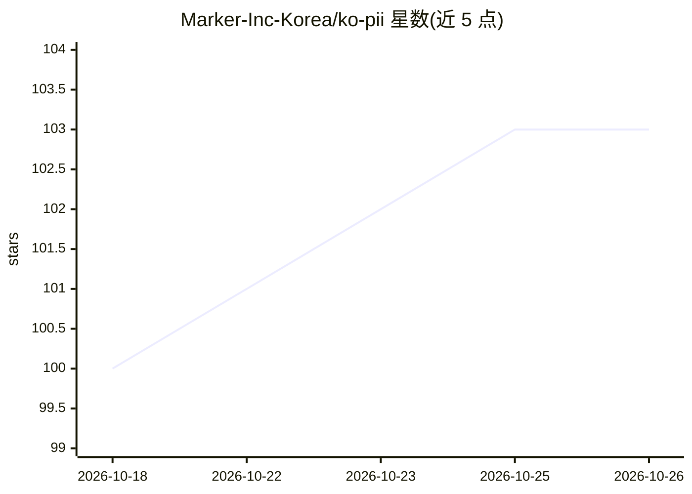

# Marker-Inc-Korea/ko-pii

⭐ 103 · Python · MIT · 推送 2026-10-22 · [GitHub](https://github.com/Marker-Inc-Korea/ko-pii) · 组织维护 · 中文 README

**韩语 PII 检测与可逆假名化 Python 库**

面向公共·受监管行业文档 RAG 与数据预处理/隐私团队的 Python 库：用规则+词典+校验和（无外部 ML 依赖、可离线）检测 33 类韩国特化 PII（住民编号、护照、事业者编号、地址、人名等），以 STRICT/PARANOID/AUDIT 等模式做可逆假名化（tokenize/redact/partial），Vault 分离存储映射并支持还原与审计日志，附 PIPA 法条自动标注。直接读取 TXT/CSV/XLSX/HWP/DOCX/PDF，提供 CLI 与 LlamaIndex/LangChain 集成。限制：规则式 PERSON 检测存在领域依赖与误报，非通用 NER。

## 筛选速览

| 维度 | 判定 | 备注 |
|---|---|---|
| AI 角色 | `ai-ecosystem` | LLM/agent 周边工具 |
| 许可风险 | `permissive` | MIT |
| 部署形态 | `library` | 以包/库形式分发 |
| 模型依赖 | — | README 未给出锁定关系 |
| 硬件要求 | — | 无带数字的原话,不猜 |
| 安装摩擦 | `low` | 无编译、无系统依赖或容器化 |
| 成熟度 | — | 结构信号不足 |

## 能力要点

- 规则+词典+校验和的确定性检测，33 类韩国 PII 类别
- 可逆假名化 + Vault 映射存储与 JSONL 审计日志
- HWP/HWPX/DOCX/PDF/CSV/XLSX 直接输入，Unicode 绕过归一化
- 处理模式分级（STRICT/PARANOID/AUDIT 等）与组合风险度、k-匿名评估

## 适用场景

- RAG 入库与 LLM 传输前拦截文档中的个人身份信息
- 公文批量假名化后对外公开或送入 LLM 处理
- Python 日志中的 PII 自动假名化
- 用自有标注文档做标签级漏检/误检对比评估

## 场景标签

 · 领域:数据隐私/文档预处理

## 证据(README 行号)

> L125: ko-pii 는 RAG 의 **인제스트(벡터 DB 진입 전)와 검색(LLM 전달 전) 양단**에서 PII 를 차단합니다. 같은 Vault 안에서는 같은 인물을 같은 토큰으로 치환해 문맥을 보존하고(Llam
> L134: - **전처리 레이어** — `DetectionResult` (label/start/end/text/confidence) 표준 객체 출력. ML 파이프라인 앞단에 끼워넣기 편함
> L16: **한국어 문서의 개인정보를 검출하고 가역적으로 가명화하는 Python 라이브러리.** 외부 ML 의존성 없이 룰 + 사전 + 체크섬만으로 동작. 공공 문서에서 특히 강하며, 어떤 ML 파이프라인의 전처리 

## 星数曲线

2026-10-18 100 → 2026-10-26 103（+3）

---
*卡片 v1 · prompt 1.4 · 生成 2026-10-23 · 置信度 high · 依据 README sha `9630851f0b58` · [字段定义](../../DATASET.md)*
