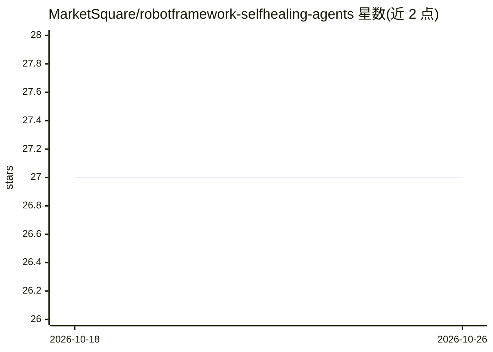

# MarketSquare/robotframework-selfhealing-agents

⭐ 27 · Python · Apache-2.0 · 推送 2026-02-05 · [GitHub](https://github.com/MarketSquare/robotframework-selfhealing-agents) · 组织维护

**自动修复 Robot Framework 失败测试的 LLM 库（当前修复失效定位器）**

Robot Framework 测试库，在测试失败时通过多 Agent LLM 工作流自动修复失效的页面定位器：支持从 DOM 组装候选并由 LLM 选择，或让 LLM 直接生成定位建议；运行时钩子使修复后测试继续执行，并输出动作日志、修复文件、Diff 与 JSON 摘要报告。面向使用 Browser/Selenium 的自动化测试开发者，支持 OpenAI、Azure OpenAI、LiteLLM 及可插拔自定义端点，Appium 在计划中。当前仅覆盖定位器失效这一类故障。

## 筛选速览

| 维度 | 判定 | 备注 |
|---|---|---|
| AI 角色 | `ai-ecosystem` | LLM/agent 周边工具 |
| 许可风险 | `permissive` | Apache-2.0 |
| 部署形态 | `library` | 以包/库形式分发 |
| 模型依赖 | locked-api |  |
| 硬件要求 | — | 无带数字的原话,不猜 |
| 安装摩擦 | `low` | 无编译、无系统依赖或容器化 |
| 成熟度 | — | 结构信号不足 |

## 能力要点

- 多 Agent LLM 工作流自动修复失效定位器（后续版本扩展其他故障类型）
- 运行时钩子使测试在定位器修复后继续运行
- 输出动作日志、修复文件副本、Diff 与 JSON 摘要四类报告
- 支持 OpenAI / Azure OpenAI / LiteLLM 及可插拔自定义端点

## 适用场景

- 前端 UI 变更导致定位器失效时自动修复并继续跑测试
- 审查 LLM 修复内容（通过 Diff 与摘要报告）
- 通过自定义端点满足数据合规要求运行自修复测试

## 场景标签

`多智能体` `编码 Agent` · 领域:Agent 开发

## 证据(README 行号)

> L8: A robotframework library that **repairs failing Robot Framework tests automatically** using **Large Language Models
> L22: - 🤖 **LLM multi-agent** workflow (extensible for more error types)
> L24: - 🔌 Supports **OpenAI, Azure OpenAI, LiteLLM** and pluggable providers

## 星数曲线

2026-10-18 27 → 2026-10-26 27（+0）

---
*卡片 v1 · prompt 1.4 · 生成 2026-10-26 · 置信度 high · 依据 README sha `4d9785253673` · [字段定义](../../DATASET.md)*
