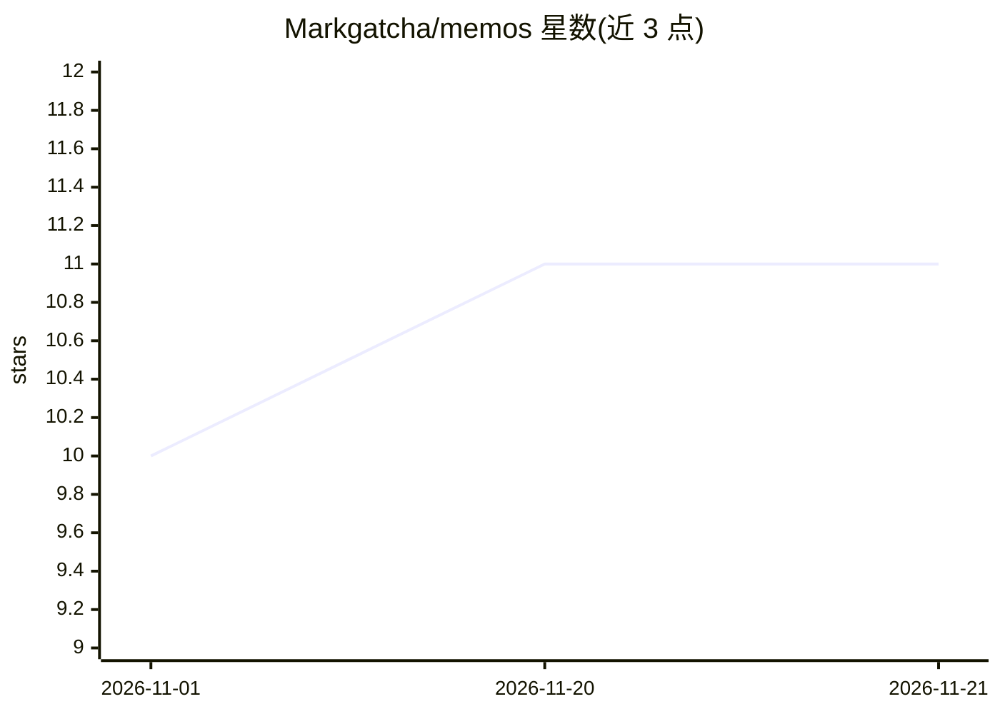

# Markgatcha/memos

⭐ 11 · TypeScript · MIT · 推送 2026-11-17 · [GitHub](https://github.com/Markgatcha/memos) · [官网](https://context-core.dev/memos/) · 个人维护

**为 AI agent 提供本地 SQLite 持久记忆层的工具**

MemOS 以单个 SQLite 文件为存储，为 MCP 客户端与 agent 提供跨会话持久记忆，无需云端与 API key。提供 TypeScript SDK、CLI、MCP server（stdio/Streamable HTTP）与 HTTP API 四种接口；检索层组合 SQLite FTS5 与 embeddings，支持带类型边的图记忆、时间有效性、信任分与来源追踪；提供 connect 命令自动写入各 harness 的 MCP 配置，可导入 ChatGPT/Claude 记忆并导出 JSON/Markdown/Obsidian。MIT 许可，无付费层。

## 筛选速览

| 维度 | 判定 | 备注 |
|---|---|---|
| AI 角色 | `ai-ecosystem` | LLM/agent 周边工具 |
| 许可风险 | `permissive` | MIT |
| 部署形态 | `library` | 以包/库形式分发 |
| 模型依赖 | local-ok | 支持本地模型 |
| 硬件要求 | — | 无带数字的原话,不猜 |
| 安装摩擦 | `low` | 无编译、无系统依赖或容器化 |
| 成熟度 | — | 结构信号不足 |

## 能力要点

- 单文件 SQLite 存储：可复制、备份、加密、删除，无网络调用
- 混合检索：SQLite FTS5 + embeddings 融合并做相关性门控
- 图记忆与时间有效性：typed edges、validFrom/validTo 点时检索
- 四种接口：TypeScript SDK、CLI、MCP server、HTTP API 共用同一存储

## 适用场景

- 为 Claude Code/Cursor 等 MCP 客户端接入跨重启的持久记忆
- 将本地笔记文件夹导入后进行语义检索
- 需要记忆可导出、可审计、不依赖云服务的 agent 场景

## 场景标签

`Agent 记忆` · 领域:Agent 开发

## 证据(README 行号)

> L5:  Local-first, persistent memory for AI agents — in a file you own.
> L92: |MCP native|stdio and Streamable HTTP, with a published compatibility policy|
> L93: |Four surfaces|TypeScript SDK, CLI, MCP server, HTTP API — all on the same store|

## 星数曲线

2026-11-01 10 → 2026-11-21 11（+1）

---
*卡片 v1 · prompt 1.4 · 生成 2026-11-20 · 置信度 high · 依据 README sha `d24de53e4706` · [字段定义](../../DATASET.md)*
