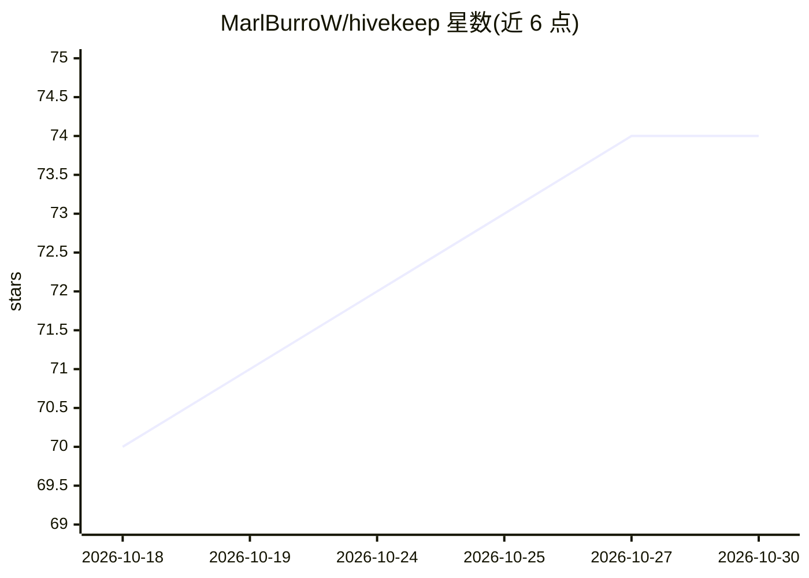

# MarlBurroW/hivekeep

⭐ 74 · TypeScript · MIT · 推送 2026-10-29 · [GitHub](https://github.com/MarlBurroW/hivekeep) · [官网](https://hivekeep.app) · 个人维护

**自托管持久多 Agent 平台：常驻记忆的 AI 团队跑在自己服务器上**

以单容器（单进程 + 单 SQLite 文件）部署的自托管 AI Agent 平台，面向个人与小组。每个 Agent 拥有持续会话与双通道长期记忆（压缩时自动抽取 + 显式记忆工具，sqlite-vec KNN 与 FTS5 融合检索），Agent 之间可协作、委派子 Agent 与执行定时任务。内置配置型 Agent Queenie（45+ 工具）通过对话完成接入配置，机密存入 AES-256-GCM 加密库且不暴露给模型。Agent 可自建工具、Mini-App 与 npm 插件；支持 Telegram/Discord/Slack/WhatsApp/Signal/Matrix 六个渠道与 PWA。提供原生安装脚本与 Docker 两种安装方式。作者声明成熟度约 80%、存在已知粗糙之处。

## 筛选速览

| 维度 | 判定 | 备注 |
|---|---|---|
| AI 角色 | `ai-native` | 本体是模型或模型工具 |
| 许可风险 | `permissive` | MIT |
| 部署形态 | `self-host` | docker 或自建部署 |
| 模型依赖 | local-ok | 支持本地模型 |
| 硬件要求 | — | 无带数字的原话,不猜 |
| 安装摩擦 | `low` | 无编译、无系统依赖或容器化 |
| 成熟度 | `idea` | |

## 能力要点

- 持久会话 + 混合长期记忆（sqlite-vec KNN 与 FTS5 融合、时间衰减重排）
- 单容器部署：无 Postgres/Redis/Mongo，仅一个 SQLite 文件
- Agent 可自建工具、Mini-App（沙箱 iframe）与 npm 插件（带类型化 SDK 与内置市场）
- AES-256-GCM 机密库，密钥不经 LLM；按 Agent/模型/日的 token 用量统计

## 适用场景

- 在家里的服务器上运行一组有记忆的个人 AI 助手
- 通过 Telegram/WhatsApp 等聊天渠道随时调度多个 Agent
- 让 Agent 自动构建小工具与应用扩展平台功能
- 家庭自动化、日程邮件处理等场景的私有 AI 部署

## 场景标签

`Agent 记忆` `多智能体` `AI 助手` `Agent 框架` · 领域:Agent 开发

## 证据(README 行号)

> L7:  A self-hosted platform of persistent AI agents that remember, collaborate, and answer you everywhere, in a single c
> L31: Most AI tools treat every conversation as disposable. You explain yourself on Monday, they have forgotten by Tuesda
> L115: Bring one config per provider and Hivekeep auto-detects its capabilities (`llm`, `embedding`, `image`, `search`, `

## 星数曲线

2026-10-18 70 → 2026-10-30 74（+4）

---
*卡片 v1 · prompt 1.4 · 生成 2026-10-24 · 置信度 high · 依据 README sha `8b91d9cd6e5d` · [字段定义](../../DATASET.md)*
