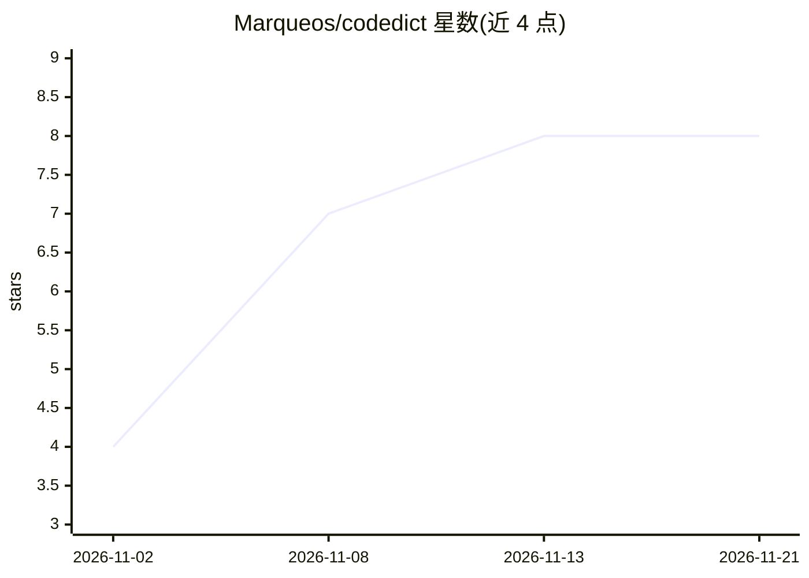

# Marqueos/codedict

⭐ 8 · Python · MIT · 推送 2026-10-28 · [GitHub](https://github.com/Marqueos/codedict) · 个人维护

**为 AI 编码会话构建本地代码索引，减少读取项目的 token 消耗**

用 tree-sitter 一次性解析项目（函数、类、HTTP 路由、SQL 表与调用关系），存入本地 SQLite 索引（FTS5 检索），在用户提问时通过 Claude Code hook 将检索结果随问题一起交给 AI，使回答从 5-20 轮降至 1-2 轮。自述基准测得 token 减少 63%、12/12 回答正确。支持 Python/JS/TS/C#/Java/Go 等 8 种语言，可扩展新语言；附 MCP 服务器接入其他工具，支持英语和葡萄牙语查询。维护者称每个会话仍有固定上下文成本，模糊问题无法命中索引。

## 筛选速览

| 维度 | 判定 | 备注 |
|---|---|---|
| AI 角色 | `ai-ecosystem` | LLM/agent 周边工具 |
| 许可风险 | `permissive` | MIT |
| 部署形态 | `desktop` | 安装包/桌面程序 |
| 模型依赖 | local-ok | 支持本地模型 |
| 硬件要求 | — | 无带数字的原话,不猜 |
| 安装摩擦 | `medium` | 含编译或系统依赖之一 |
| 成熟度 | — | 结构信号不足 |

## 能力要点

- tree-sitter + SQLite FTS5 的确定性索引，构建索引不消耗 token
- 通过 Claude Code hook 自动注入检索结果
- 提供 MCP 服务器接入 Cursor、Codex、Gemini CLI 等工具
- 变更文件增量重索引，支持跨语言调用桥接与 PageRank 排序

## 适用场景

- 降低 Claude Code 会话的 token 与轮次消耗
- 在 Cursor、Gemini CLI 等工具中通过 MCP 查询代码结构
- 离线回答代码位置与调用链问题（RAG 模式）
- 生成带 Mermaid 图的项目结构文档手册

## 场景标签

`RAG` · 领域:知识与检索

## 证据(README 行号)

> L9:  It reads your project once, with no AI, and hands the answer over together with the question.
> L55: The idea was to do the search work **once, with no AI**, in a local index, and hand the ready answer over together 
> L107: |**The AI**|`.codedict/ai/`, `codedict search` and the MCP server|A compact map of the project and ready answers p

## 星数曲线

2026-11-02 4 → 2026-11-21 8（+4）

---
*卡片 v1 · prompt 1.4 · 生成 2026-11-20 · 置信度 high · 依据 README sha `6d4e4de21d0b` · [字段定义](../../DATASET.md)*
