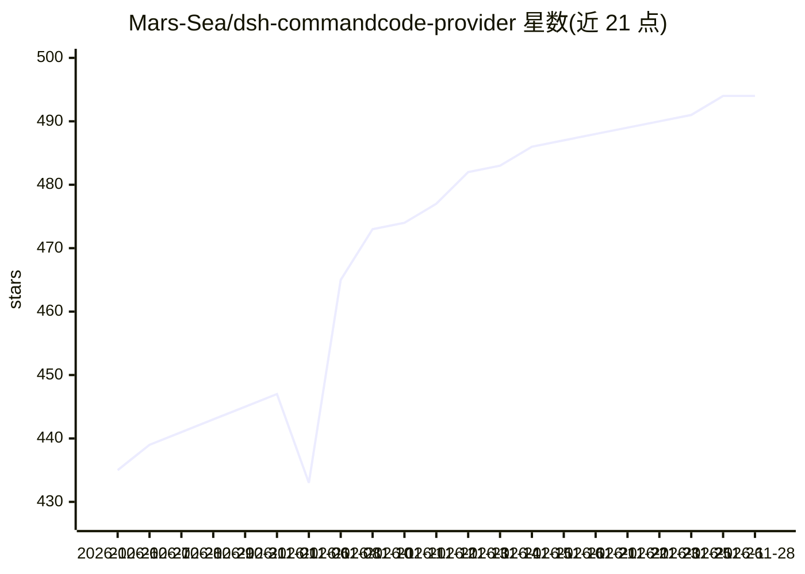

# Mars-Sea/dsh-commandcode-provider

⭐ 494 · TypeScript · MIT · 推送 2026-11-22 · [GitHub](https://github.com/Mars-Sea/dsh-commandcode-provider) · [官网](https://www.npmjs.com/package/@mars-sea/dsh-commandcode-provider) · 个人维护 · 中文 README

**为 dsh 提供 Command Code 模型接入的插件**

非官方的 DeepSeek Harness（dsh）LLM provider 插件，接入 Command Code 模型服务。通过一条 dsh plugin 命令安装，提供实时模型目录、按套餐分层标注（tier/折扣/峰谷时段/图像支持/上下文窗口）、多账户轮换与专用模型路由、浏览器授权登录、用量面板 /commandcode、会话成本估算、reasoning effort 档位与图像输入、基于 Command Code 端点的 web_search、可选 ZDR 路由。需 Node.js ≥24.9，需自备 Command Code 账户与 API key。

## 筛选速览

| 维度 | 判定 | 备注 |
|---|---|---|
| AI 角色 | `ai-ecosystem` | LLM/agent 周边工具 |
| 许可风险 | `permissive` | MIT |
| 部署形态 | `library` | 以包/库形式分发 |
| 模型依赖 | locked-api |  |
| 硬件要求 | — | 无带数字的原话,不猜 |
| 安装摩擦 | `low` | 无编译、无系统依赖或容器化 |
| 成熟度 | — | 结构信号不足 |

## 能力要点

- 实时模型目录，含套餐层级、折扣/FREE、峰谷、图像与上下文窗口标注
- 多账户轮换：额度耗尽自动切换，可固定偏好账户或指定专用模型
- 浏览器授权登录与本地凭据存储，支持 COMMANDCODE_API_KEY 等多种密钥来源
- web 与 dsh-TUI 双 profile 安装，各 profile 独立管理插件列表

## 适用场景

- 在 dsh 中通过 Command Code 账户使用其模型目录
- 多个 Command Code 订阅额度用尽时自动切换账户
- 在终端 UI 中选择模型并查看每账户用量报表

## 场景标签

 · 领域:LLM 基础设施/模型接入

## 证据(README 行号)

> L13: Unofficial DeepSeek Harness LLM provider plugin for **Command Code**, ported from pi-commandcode-provider (MIT).
> L31: - **Plugin bundle** — one `dsh plugin add` installs a `commandcode` provider route with the live model catalog.

## 星数曲线

2026-10-26 435 → 2026-11-28 494（+59）

---
*卡片 v1 · prompt 1.4 · 生成 2026-11-25 · 置信度 high · 依据 README sha `4c966d17fc1f` · [字段定义](../../DATASET.md)*
