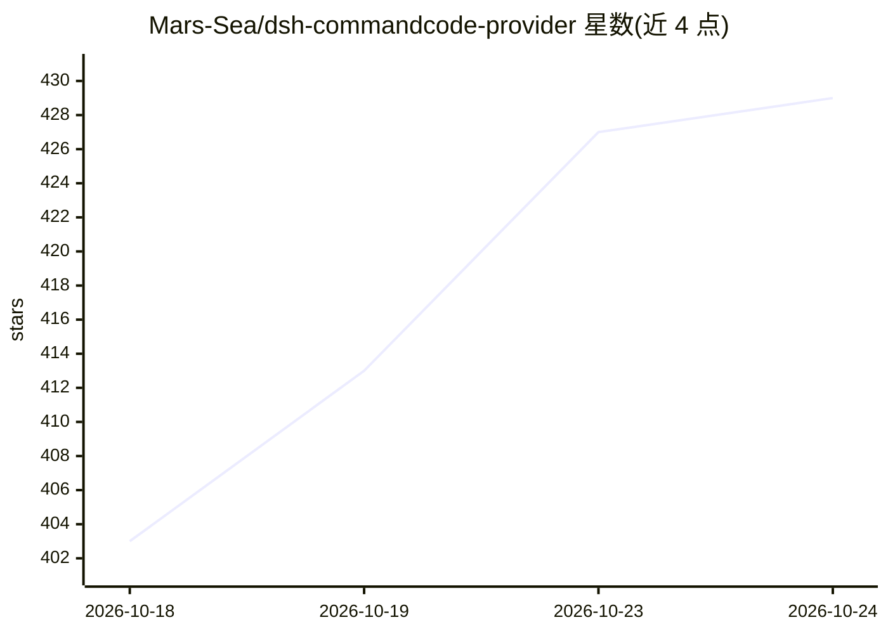

# Mars-Sea/dsh-commandcode-provider

⭐ 433 · TypeScript · MIT · 推送 2026-10-24 · [GitHub](https://github.com/Mars-Sea/dsh-commandcode-provider) · [官网](https://www.npmjs.com/package/@mars-sea/dsh-commandcode-provider) · 个人维护 · 中文 README

**为 DeepSeek Harness 接入 Command Code 模型的 dsh 插件**

DeepSeek Harness (dsh) 的非官方 LLM provider 插件，将 Command Code 模型接入 dsh：注册 commandcode provider 路由与实时模型目录，提供专属设置页、多账号额度轮换、计划感知的模型过滤、推理力度选择、图像输入，并通过 Command Code API 支撑 dsh 的 web_search 工具；附带服务状态展示、模型用量/成本分析与会话成本估算。通过 dsh plugin add 安装，支持 web 与 dsh-TUI 两种 profile，需自备 Command Code 账号与 API key。仅支持 dsh 0.2.0-rc.2 / 0.2.1-rc.2 两个引擎版本。

## 筛选速览

| 维度 | 判定 | 备注 |
|---|---|---|
| AI 角色 | `ai-ecosystem` | LLM/agent 周边工具 |
| 许可风险 | `permissive` | MIT |
| 部署形态 | `library` | 以包/库形式分发 |
| 模型依赖 | — | README 未给出锁定关系 |
| 硬件要求 | — | 无带数字的原话,不猜 |
| 安装摩擦 | `low` | 无编译、无系统依赖或容器化 |
| 成熟度 | `idea` | |

## 能力要点

- 注册 commandcode provider 路由与实时模型目录
- 多账号自动轮换（单账号额度用尽切换下一账号）
- web_search 由 Command Code /alpha/web-search 支撑，与聊天共用同一 key
- 模型用量/成本分析与会话成本估算（标注为估算非账单）

## 适用场景

- 在 dsh 中使用 Command Code 订阅内的模型
- 在终端 UI (dsh-TUI) 中配置并切换 Command Code 模型
- 查看账号计划、配额窗口与用量成本估算

## 场景标签

`模型网关` · 领域:Agent 开发

## 证据(README 行号)

> L13: Unofficial DeepSeek Harness LLM provider plugin for **Command Code**, ported from pi-commandcode-provider (MIT).
> L19: - **Plugin bundle** — install into any dsh profile with `dsh plugin add`; registers a `commandcode` provider route 

## 星数曲线

2026-10-18 403 → 2026-10-24 429（+26）

---
*卡片 v1 · prompt 1.4 · 生成 2026-10-22 · 置信度 high · 依据 README sha `6ba26531cd4f` · [字段定义](../../DATASET.md)*
