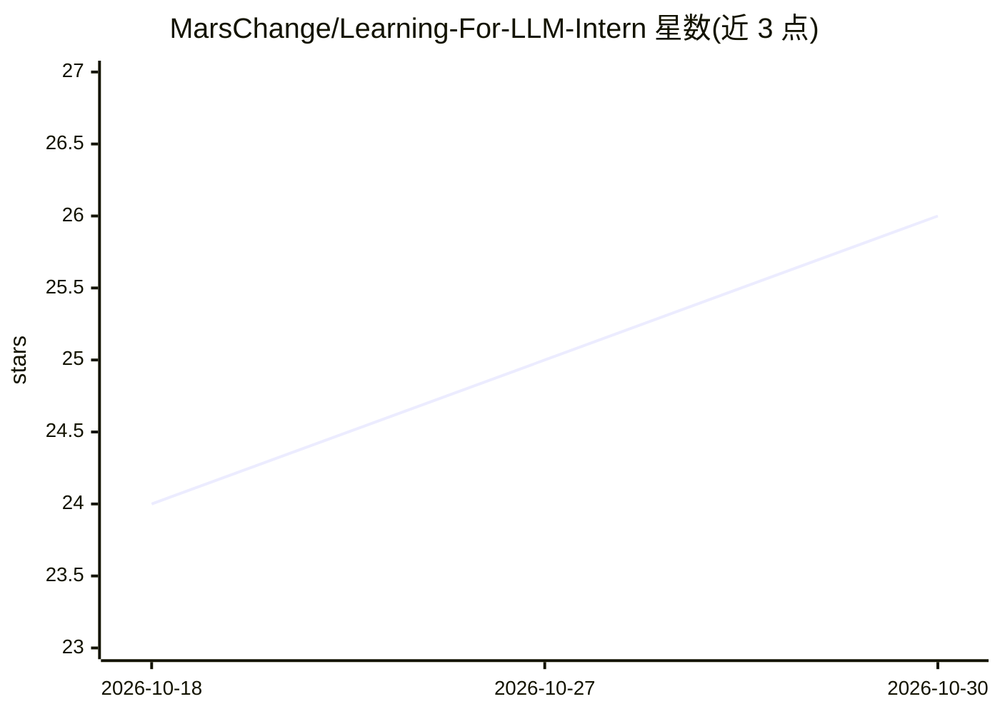

# MarsChange/Learning-For-LLM-Intern

⭐ 26 · 推送 2026-07-17 · [GitHub](https://github.com/MarsChange/Learning-For-LLM-Intern) · 个人维护 · 中文 README

**面向大模型算法实习面试的个人学习笔记库（Obsidian）**

用 Obsidian 管理的 Markdown 学习笔记库，覆盖大模型算法、后训练/RL、推理系统、训练系统工程、Agent 框架、常考手撕与多模态等主题。提供全局学习地图、按岗位（算法/推理系统/Agent RL）划分的四条推荐阅读路线、五份八股文件的三遍刷法、手撕题三步法与统一笔记结构（面试定位→代码→测试用例→易错点）。内容围绕面试复述与手写验证组织，并给出新增笔记的维护规范。面向准备大模型相关实习面试的学习者。

## 筛选速览

| 维度 | 判定 | 备注 |
|---|---|---|
| AI 角色 | `ai-knowledge` | 知识聚合/清单类 |
| 许可风险 | `none` | — |
| 部署形态 | `None` |  |
| 模型依赖 | — | README 未给出锁定关系 |
| 硬件要求 | — | 无带数字的原话,不猜 |
| 安装摩擦 | `low` | 无编译、无系统依赖或容器化 |
| 成熟度 | — | 结构信号不足 |

## 能力要点

- 覆盖算法/后训练 RL/推理与训练系统/Agent 四条岗位化阅读路线
- 五份八股文件配套多遍刷法与面试输出模板
- 常考手撕目录含 12 类题目，按 ACM 输入输出与测试用例结构组织
- 规定新增笔记的统一结构与维护规范

## 适用场景

- 准备大模型算法/推理系统/Agent 岗位实习面试时按路线复习
- 面试前刷八股文件并做口头复述和代码默写
- 按统一结构积累和扩展自己的学习笔记

## 场景标签

`教程课程` · 领域:学习与行业

## 证据(README 行号)

> L3: 面向大模型算法、后训练、推理系统和 Agent 实习面试的个人学习笔记库。这个仓库不是论文资料合集，而是一套可以反复复习、面试复述、手写验证和继续扩展的 Obsidian Markdown 笔记。
> L9: 如果你已经在准备面试，不建议从头到尾顺序背完。更高效的方式是按岗位问题反推阅读路线：
> L122: ## 五份八股文件怎么刷

## 星数曲线

2026-10-18 24 → 2026-10-30 26（+2）

---
*卡片 v1 · prompt 1.4 · 生成 2026-10-27 · 置信度 high · 依据 README sha `8fd1cd223a47` · [字段定义](../../DATASET.md)*
