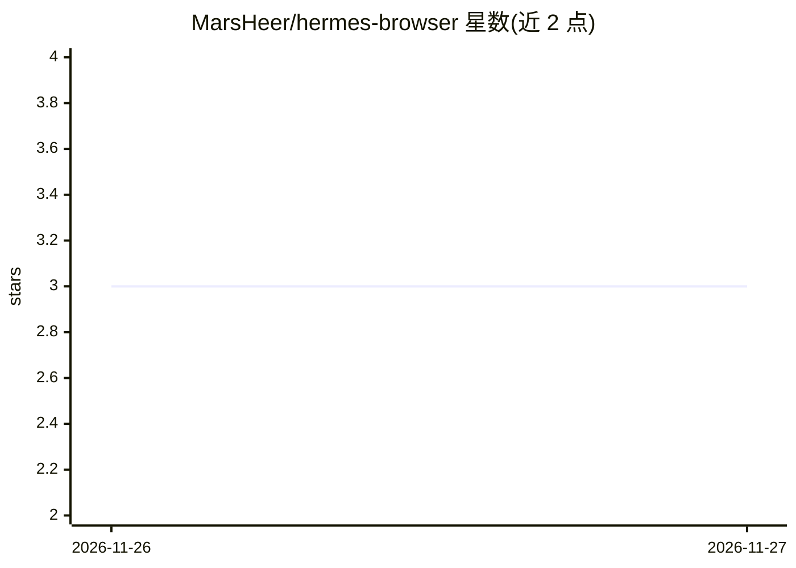

# MarsHeer/hermes-browser

⭐ 3 · JavaScript · MIT · 推送 2026-11-24 · [GitHub](https://github.com/MarsHeer/hermes-browser) · 个人维护

**让 Hermes agent 或 MCP 客户端操控真实 Chrome 浏览器的桥接工具**

由 Node MCP 服务器（bridge）与 Manifest V3 Chrome 扩展组成的桥接层：agent 在独立后台标签页运行，通过 chrome.debugger 发送真实鼠标键盘事件，提供标签管理、页面读取、点击输入、截图等 17 个 MCP 工具。带可见光标、点击涟漪与高亮的操作指示层，以及可随时暂停所有 agent 的 Stop 按钮；每个 agent 使用各自标签页避免互相干扰。安装方式为 git clone 后 npm 安装并侧载扩展，支持本地与云端 Hermes（经 ngrok 隧道）同时接入。

## 筛选速览

| 维度 | 判定 | 备注 |
|---|---|---|
| AI 角色 | `ai-ecosystem` | LLM/agent 周边工具 |
| 许可风险 | `permissive` | MIT |
| 部署形态 | `desktop` | 安装包/桌面程序 |
| 模型依赖 | — | README 未给出锁定关系 |
| 硬件要求 | — | 无带数字的原话,不猜 |
| 安装摩擦 | `low` | 无编译、无系统依赖或容器化 |
| 成熟度 | — | 结构信号不足 |

## 能力要点

- 17 个 MCP 工具覆盖标签、导航、读取、点击、输入、截图与对话框处理
- 后台标签运行：agent 不抢占用户当前标签页，操作指示层对截图与页面读取隐藏
- Stop 按钮可即时暂停所有 agent，恢复前工具返回等待提示
- 支持本地与云端 Hermes 双桥接共享同一浏览器，自动接管转发

## 适用场景

- 让 AI agent 用我已登录的真实 Chrome 代为操作网页
- agent 后台处理网页任务的同时我继续浏览其他标签页
- 通过 ngrok 隧道让云端 agent 操控我本机浏览器

## 场景标签

`浏览器自动化` · 领域:效率与自动化

## 证据(README 行号)

> L3: Let a Hermes agent (or any MCP client) control **your real Chrome**: your tabs, your sign-ins. It works the same way
> L8: Hermes ──MCP (stdio)──▶ bridge/server.mjs ──WebSocket 127.0.0.1:8765 (token)──▶ Chrome extension ──CDP──▶ tabs
> L11: - **`bridge/`**: a Node MCP server. Hermes launches it. It listens on localhost for the extension.

## 星数曲线

2026-11-26 3 → 2026-11-27 3（+0）

---
*卡片 v1 · prompt 1.4 · 生成 2026-11-26 · 置信度 high · 依据 README sha `c2e10013dff8` · [字段定义](../../DATASET.md)*
