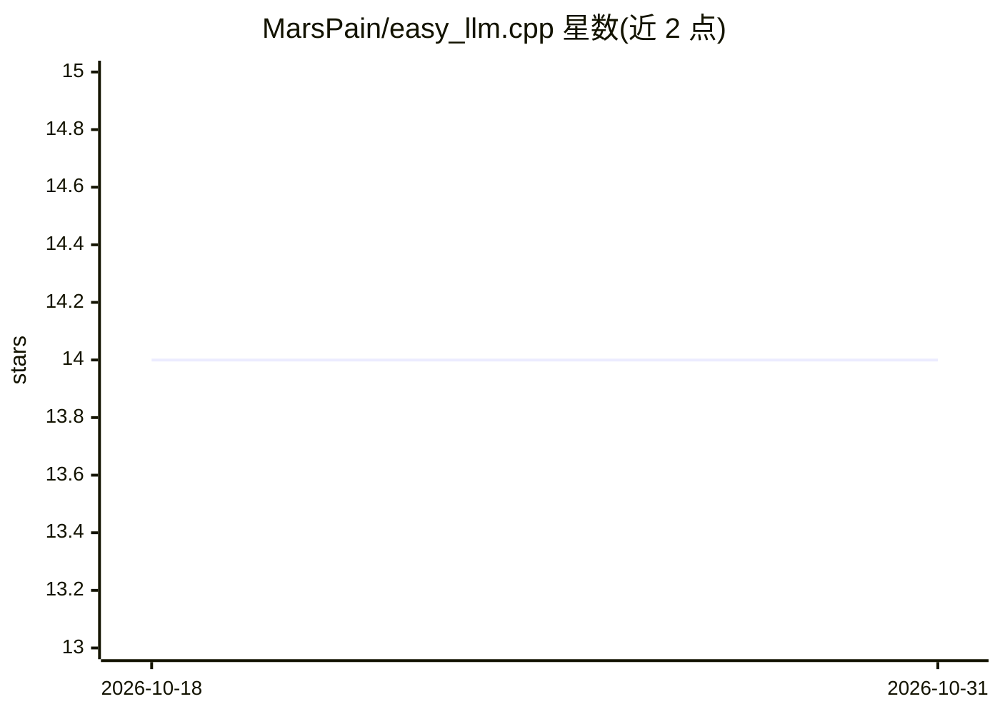

# MarsPain/easy_llm.cpp

⭐ 14 · C++ · 推送 2026-02-26 · [GitHub](https://github.com/MarsPain/easy_llm.cpp) · 个人维护 · 中文 README

**用于学习 LLM 推理流程的最小 C++ 框架（默认 Qwen2.5-0.5B）**

以可读性为目标的 C++ LLM 推理实现：覆盖配置加载、权重加载（safetensors）、tokenizer、prefill/decode、KV cache 与采样解码的完整路径，默认面向 Qwen2.5-0.5B，可在单机 CPU 上跑通端到端推理。提供一次性 CLI 推理与持续批处理服务模式（--serve），支持 greedy/Top-K/Top-P 采样与 OpenMP/CUDA 可选加速。第三方依赖仅 vendored 的 spdlog 与 nlohmann/json，面向课程、原型与自学，不以峰值服务性能为目标。

## 筛选速览

| 维度 | 判定 | 备注 |
|---|---|---|
| AI 角色 | `ai-ecosystem` | LLM/agent 周边工具 |
| 许可风险 | `none` | — |
| 部署形态 | `None` |  |
| 模型依赖 | — | README 未给出锁定关系 |
| 硬件要求 | — | 无带数字的原话,不猜 |
| 安装摩擦 | `high` | 编译与系统依赖俱全 |
| 成熟度 | — | 结构信号不足 |

## 能力要点

- 完整可读的推理路径：config/weights/tokenizer 到采样输出
- 持续批处理服务模式（prefill/decode 多请求调度）
- 回归/不变量测试门（CTest 标签）
- CPU 优先，可选 CUDA 加速与 OpenMP

## 适用场景

- 学习 LLM 推理各阶段（prefill/decode/KV cache）的实现
- 课程或研究原型中修改和实验推理管线
- 在单机 CPU 上快速跑通 Qwen2.5-0.5B 推理

## 场景标签

`推理引擎` `教程课程` · 领域:学习与行业

## 证据(README 行号)

> L5: A minimal C++ framework for learning and understanding the LLM inference pipeline. The project keeps the full infere
> L7: This project focuses on **correctness and architecture clarity**, not peak serving performance. Third-party dependen
> L109: - End-to-end inference path from config/weights/tokenizer to sampled output

## 星数曲线

2026-10-18 14 → 2026-10-31 14（+0）

---
*卡片 v1 · prompt 1.4 · 生成 2026-10-31 · 置信度 high · 依据 README sha `ce3f4567906e` · [字段定义](../../DATASET.md)*
