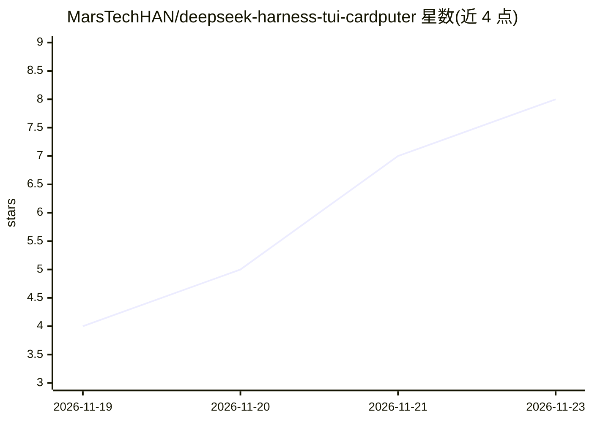

# MarsTechHAN/deepseek-harness-tui-cardputer

⭐ 8 · Rust · GPL-3.0 · 推送 2026-11-19 · [GitHub](https://github.com/MarsTechHAN/deepseek-harness-tui-cardputer) · 个人维护

**在 M5Stack Cardputer 掌机上运行的 DeepSeek agent 终端界面**

面向 M5Stack Cardputer Zero（512 MB RAM、320×170 面板、53×12 字符）的掌上 agent：以零依赖 Rust 单二进制实现完整 agent 循环，包括 turn/step 驱动、34 个工具、MCP 工具接入、权限沙箱三模式、目标持久化、自动上下文压缩、记忆与 /btw 只读旁路提问。模型能力来自 OpenAI 兼容或 DeepSeek 端点，本机不运行模型；支持图像输入、6 种界面语言与通过 GitHub Releases 自更新。无子代理常驻、无远程服务器、无遥测。

## 筛选速览

| 维度 | 判定 | 备注 |
|---|---|---|
| AI 角色 | `ai-native` | 本体是模型或模型工具 |
| 许可风险 | `viral` | GPL-3.0 |
| 部署形态 | `None` |  |
| 模型依赖 | locked-api |  |
| 硬件要求 | — | 无带数字的原话,不猜 |
| 安装摩擦 | `medium` | 含编译或系统依赖之一 |
| 成熟度 | — | 结构信号不足 |

## 能力要点

- 零依赖 Rust 单二进制（约 1 MB），完整 agent 循环运行在 512 MB 掌机
- 34 个内置工具加 MCP 服务器工具接入，权限沙箱 auto/strict/full 三模式
- 自动上下文压缩、目标持久化与跨会话记忆（AGENTS.md 与 memory_* 工具）
- 图像输入（read_image 与 /image）、流式推理面板与 6 语言界面

## 适用场景

- 在 Cardputer 掌机上通过对话执行文件、shell 与网络任务
- 低配置设备上运行带权限管控的 agent 循环
- 用 creator 模式在设备上编写并运行技能包应用

## 场景标签

`编码 Agent` `AI 助手` · 领域:编码与开发

## 证据(README 行号)

> L5: **The whole DeepSeek Harness agent loop — turns, tools, goals, compaction — in one
> L29: `dst` is a pocket-sized agent: a terminal UI and an agent harness that run
> L50: one binary, `~/.dst` for state, an OpenAI-compatible (or DeepSeek) endpoint for

## 星数曲线

2026-11-19 4 → 2026-11-23 8（+4）

---
*卡片 v1 · prompt 1.4 · 生成 2026-11-21 · 置信度 high · 依据 README sha `4721e4f157b4` · [字段定义](../../DATASET.md)*
