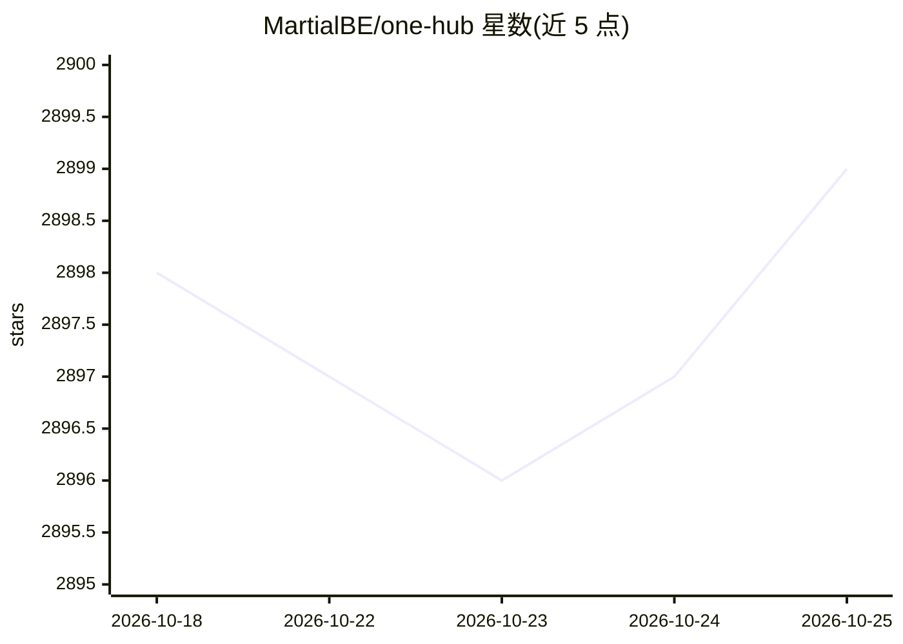

# MartialBE/one-hub

⭐ 2,899 · Go · Apache-2.0 · 推送 2026-02-19 · [GitHub](https://github.com/MartialBE/one-hub) · [官网](https://one-hub.xiao5.info/) · 个人维护 · 中文 README

**OpenAI 接口管理与分发系统：多供应商聚合、计费统计**

基于 one-api 二次开发的 LLM API 网关与分发系统，面向需要统一管理多家模型供应商接口的开发者/站长。将 OpenAI、Azure、Anthropic、Gemini、百度文心、通义千问、Ollama 等约 25 家供应商的渠道聚合为 OpenAI 格式接口统一分发，提供用户仪表盘、管理员统计、令牌计费、模型价格自动更新、渠道测速、Telegram bot、Prometheus 监控等功能，并支持 Gemini/Claude 格式 API 请求与 Webauthn 登录。声明为个人学习项目、不保证稳定性，数据库与原版 one-api 不兼容，不得混用。

## 筛选速览

| 维度 | 判定 | 备注 |
|---|---|---|
| AI 角色 | `ai-ecosystem` | LLM/agent 周边工具 |
| 许可风险 | `permissive` | Apache-2.0 |
| 部署形态 | `None` |  |
| 模型依赖 | local-ok | 支持本地模型 |
| 硬件要求 | — | 无带数字的原话,不猜 |
| 安装摩擦 | `low` | 无编译、无系统依赖或容器化 |
| 成熟度 | — | 结构信号不足 |

## 能力要点

- 聚合约 25 家模型供应商渠道，统一以 OpenAI 格式分发
- 用户/渠道管理与计费：令牌、按次收费、倍率自定义、月度账单
- 支持 Gemini、Claude 格式 API 请求及非 OpenAI 模型的函数调用优化
- 管理员数据统计、Prometheus/Uptime Kuma 监控、模型价格自动更新

## 适用场景

- 统一接入多家模型供应商，用一个接口分发调用
- 搭建面向团队或用户的 API 计费与配额管理站点
- 本地 Ollama 等模型接入统一网关管理

## 场景标签

`模型网关` · 领域:Agent 开发

## 证据(README 行号)

> L5: _本项目是基于one-api二次开发而来的_
> L41: - 重构了中转`供应商`模块
> L69: |供应商|Chat|Embeddings|Audio|Images|其他|

## 星数曲线

2026-10-18 2,898 → 2026-10-25 2,899（+1）

---
*卡片 v1 · prompt 1.4 · 生成 2026-10-21 · 置信度 high · 依据 README sha `f1500a8357ec` · [字段定义](../../DATASET.md)*
