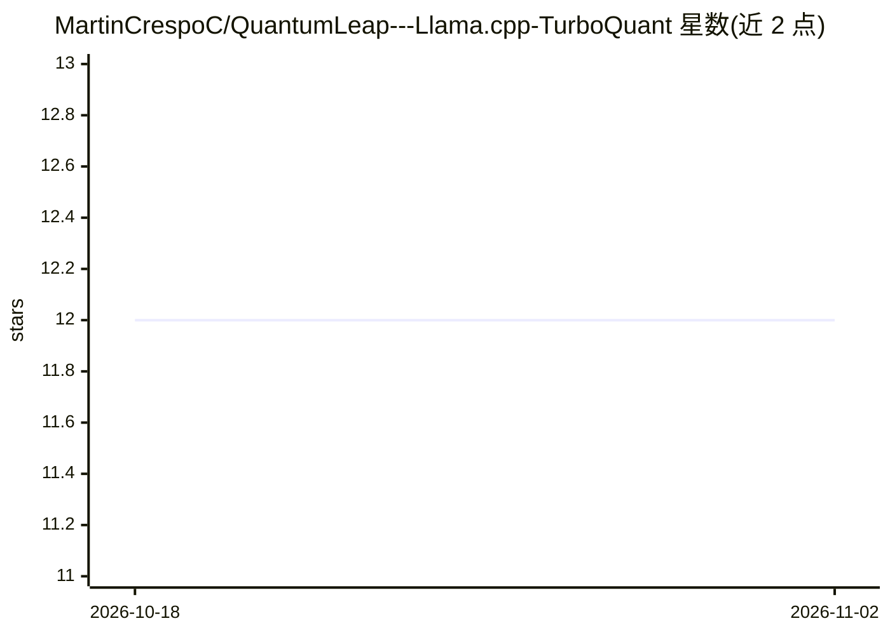

# MartinCrespoC/QuantumLeap---Llama.cpp-TurboQuant

⭐ 12 · C++ · MIT · 推送 2026-04-01 · [GitHub](https://github.com/MartinCrespoC/QuantumLeap---Llama.cpp-TurboQuant) · 个人维护

**基于 llama.cpp 的本地 LLM 推理运行时，含 MoE 优化与 KV 压缩**

构建于 llama.cpp 之上的推理服务与 Web UI：提供 ExpertFlow MoE 推理引擎（专家缓存、路由预测、传输压缩、自定义 ggml 后端）与 TurboQuant KV 缓存压缩（3.5/2.5 bit 量化），自动检测 GPU（CUDA/ROCm/Metal）并自动计算 ngl 等参数。提供 Ollama 与 OpenAI 兼容 API，可与已安装的 Ollama 共存（默认端口 11435）。通过 git clone 加 build.sh 从源码编译安装，需约 2-5 分钟构建时间，依赖 Python 3.10+。

## 筛选速览

| 维度 | 判定 | 备注 |
|---|---|---|
| AI 角色 | `ai-ecosystem` | LLM/agent 周边工具 |
| 许可风险 | `permissive` | MIT |
| 部署形态 | `None` |  |
| 模型依赖 | local-ok | 支持本地模型 |
| 硬件要求 | `gpu-8g` | |
| 安装摩擦 | `high` | 编译与系统依赖俱全 |
| 成熟度 | — | 结构信号不足 |

## 能力要点

- ExpertFlow MoE 引擎：专家缓存、Markov 路由预测、LZ77 式传输压缩、自定义 ggml 后端
- TurboQuant KV 缓存压缩（TQ3 7.4x / TQ2 9.7x）
- Ollama + OpenAI 兼容 API，与已有 Ollama 实例共存
- 自动检测 CUDA/ROCm/Metal 后端并自动优化 ngl、线程、mlock 等参数

## 适用场景

- 在低显存 GPU（如 6GB）上运行 122B 级 MoE 模型
- 用兼容 Ollama/OpenAI 的本地 API 服务替代手工配置 llama.cpp
- 在 Web UI 中管理模型、对话工作区并跑基准测试

## 场景标签

`推理引擎` `模型量化` · 领域:训练与推理

## 证据(README 行号)

> L8: Built on llama.cpp
> L69: |API|None (raw HTTP)|**Ollama + OpenAI compatible**|
> L211: QuantumLeap uses port **11435**. Ollama stays on **11434**. Both run simultaneously.

## 星数曲线

2026-10-18 12 → 2026-11-02 12（+0）

---
*卡片 v1 · prompt 1.4 · 生成 2026-11-01 · 置信度 high · 依据 README sha `9d2fb454cd28` · [字段定义](../../DATASET.md)*
