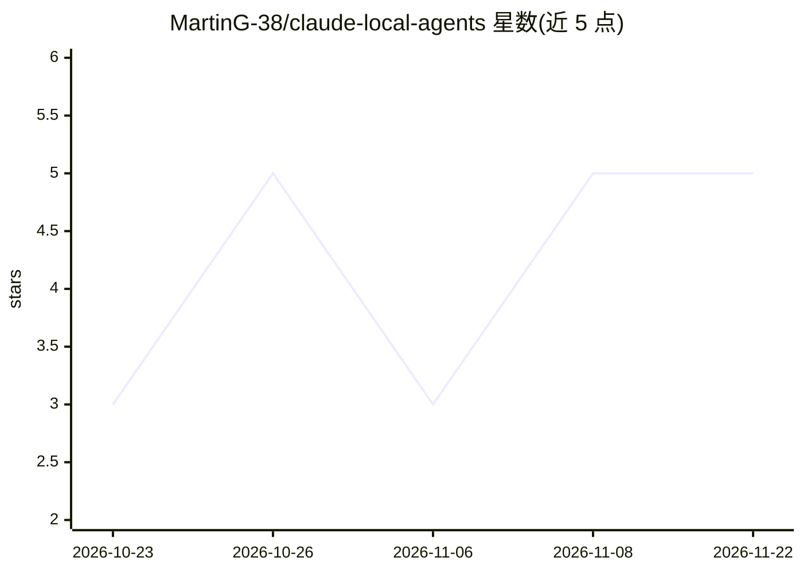

# MartinG-38/claude-local-agents

⭐ 5 · Python · MIT · 推送 2026-10-21 · [GitHub](https://github.com/MartinG-38/claude-local-agents) · 个人维护

**Claude Code 技能：把大读取和批量代码写作委派给本地 Ollama 模型以节省 token**

一个 Claude Code 技能，由 Claude Code 负责理解项目、设计与审查，将大文件读取、日志分析、批量代码写作等高消耗任务派发给本机 Ollama 运行的本地模型；本地 agent 是受限模式的 Claude Code 实例，通过 Ollama 的 Anthropic 兼容 API 连接，Claude 只读取约二十行的最终报告。提供自动测试检查（无网络沙箱内运行）、失败时模型链接管、可选升级到 Sonnet 子 agent、按模型学习任务尺寸等机制。目标用户是使用 Claude Code 且机器可运行约 24 GB 内存本地模型的开发者。状态为 experimental，Windows 与真实 Linux 机器尚未验证。

## 筛选速览

| 维度 | 判定 | 备注 |
|---|---|---|
| AI 角色 | `ai-ecosystem` | LLM/agent 周边工具 |
| 许可风险 | `permissive` | MIT |
| 部署形态 | `None` |  |
| 模型依赖 | local-ok | 支持本地模型 |
| 硬件要求 | — | 无带数字的原话,不猜 |
| 安装摩擦 | `low` | 无编译、无系统依赖或容器化 |
| 成熟度 | `idea` | |

## 能力要点

- 三个工具：内容问答、只读代码探索、带检查的代码任务
- 无网络沙箱中自动运行测试，失败在同会话内修复
- 模型链接管：前一模型失败后下一个带失败摘要接手
- 内存感知：按各模型占用选择可装下的最佳模型，独立任务可在 git worktree 并行

## 适用场景

- 用本地模型读取大型日志和测试输出，节省 Claude 配额
- 把规格明确的批量代码写作任务委派给本地模型并由测试把关
- 隐私场景下全程不使用云端，所有工作留在本机

## 场景标签

`编码 Agent` `代码生成` · 领域:编码与开发

## 证据(README 行号)

> L34: Each local agent is an instance of Claude Code in restricted mode, connected to Ollama's
> L43: - **Three tools**: a question about content you provide (`ask_local.py`), a read-only code
> L81: - An up-to-date Claude Code (`claude update`), git,

## 星数曲线

2026-10-23 3 → 2026-11-22 5（+2）

---
*卡片 v1 · prompt 1.4 · 生成 2026-11-21 · 置信度 high · 依据 README sha `7f608a4fc078` · [字段定义](../../DATASET.md)*
