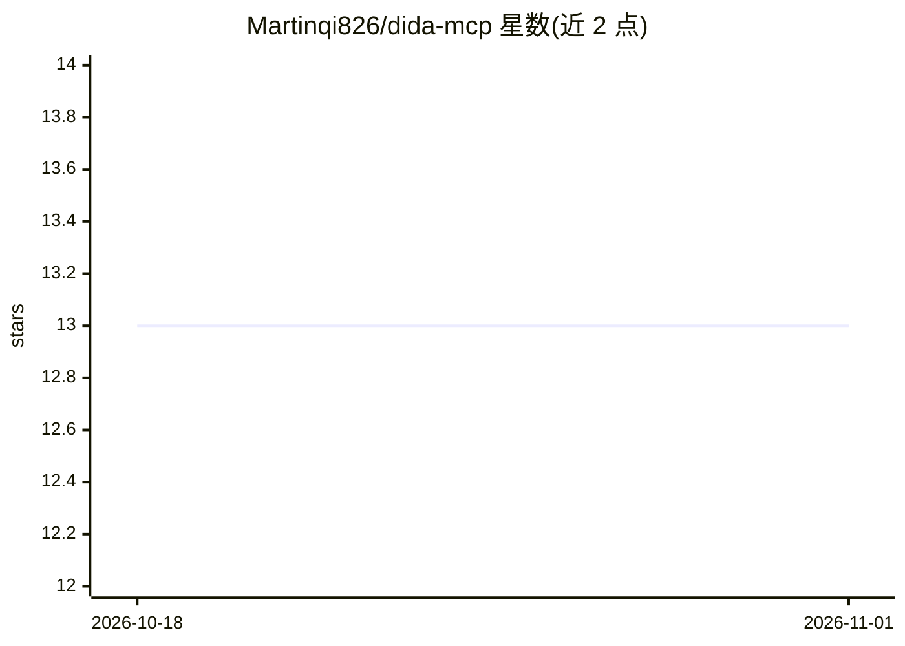

# Martinqi826/dida-mcp

⭐ 13 · Python · MIT · 推送 2026-03-23 · [GitHub](https://github.com/Martinqi826/dida-mcp) · 个人维护 · 中文 README

**让 AI 助手通过 MCP 协议操控滴答清单的本地服务器**

面向滴答清单（中国版 dida365.com）用户的 MCP Server：通过 OAuth 授权访问滴答清单 Open API，向 AI 客户端暴露 13 个工具，覆盖项目增删查、任务增改删与完成、按到期/逾期/优先级查询和关键词搜索。支持接入 Claude Desktop、CodeBuddy 等任意 MCP 客户端；OpenClaw 需经 mcporter 桥接并配置 TOOLS.md。以 Python 包源码安装（pip install -e .），附 CLI 完成授权、测试与运行。国际版 TickTick 用户需自行修改 API 地址；删除操作不可恢复。

## 筛选速览

| 维度 | 判定 | 备注 |
|---|---|---|
| AI 角色 | `ai-ecosystem` | LLM/agent 周边工具 |
| 许可风险 | `permissive` | MIT |
| 部署形态 | `library` | 以包/库形式分发 |
| 模型依赖 | — | README 未给出锁定关系 |
| 硬件要求 | — | 无带数字的原话,不猜 |
| 安装摩擦 | `low` | 无编译、无系统依赖或容器化 |
| 成熟度 | — | 结构信号不足 |

## 能力要点

- 13 个工具覆盖项目/任务管理、到期与逾期查询、优先级筛选、关键词搜索
- OAuth 授权流程，Token 保存于本地 ~/.dida-mcp/token.json
- stdio 模式 MCP Server，适配任意 MCP 客户端
- 提供 mcporter 桥接方案接入 OpenClaw

## 适用场景

- 用对话让 AI 助手创建、完成、搜索滴答清单任务
- 每日向 AI 询问今天到期或逾期的任务
- 让 AI 按优先级整理待办清单

## 场景标签

`AI 助手` · 领域:对话与助手

## 证据(README 行号)

> L5: MCP Protocol
> L8: **滴答清单 (Dida365) MCP Server** — 让 AI 助手控制你的滴答清单。
> L12: 适用于 OpenClaw (龙虾)、Claude Desktop、CodeBuddy 以及任何支持 MCP 协议的 AI 客户端。

## 星数曲线

2026-10-18 13 → 2026-11-01 13（+0）

---
*卡片 v1 · prompt 1.4 · 生成 2026-10-31 · 置信度 mid · 依据 README sha `ba90345e6ed0` · [字段定义](../../DATASET.md)*
