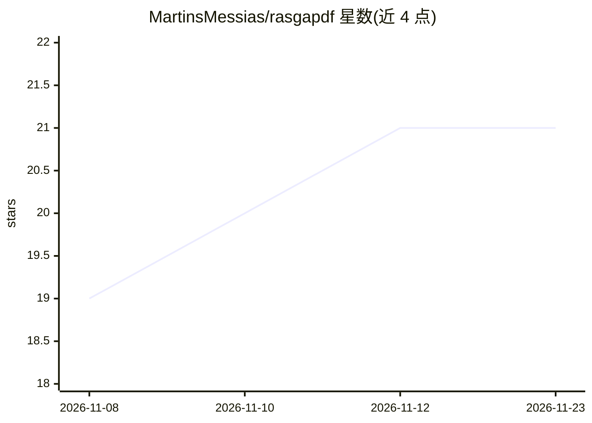

# MartinsMessias/rasgapdf

⭐ 21 · Rust · AGPL-3.0 · 推送 2026-11-12 · [GitHub](https://github.com/MartinsMessias/rasgapdf) · [官网](https://martinsmessias.github.io/rasgapdf/) · 个人维护

**纯 Rust 实现的 2D 空间 PDF 解析库，输出精确坐标与结构化文档**

以纯 Rust 实现的 PDF 解析库，核心是返回每个字符、行、块与表格的精确物理坐标 [x0, y0, x1, y1]，并提供两种模式：扁平 Raw X/Y 坐标输出（约 3-8ms/页）与层级结构化文档（含表格自动检测，约 8-15ms/页）。通过 C-ABI FFI 提供 Python、Node.js、Go、C# 原生绑定，附带 CLI 工具、MCP Server（供 Claude Desktop/Cursor 等 agent 调用）、LangChain/LlamaIndex loader 与空间分块函数，面向 RAG 管线与 LLM 场景。许可为 AGPL-3.0，另提供商业许可豁免。

## 筛选速览

| 维度 | 判定 | 备注 |
|---|---|---|
| AI 角色 | `ai-ecosystem` | LLM/agent 周边工具 |
| 许可风险 | `dual` | AGPL-3.0 |
| 部署形态 | `library` | 以包/库形式分发 |
| 模型依赖 | — | README 未给出锁定关系 |
| 硬件要求 | — | 无带数字的原话,不猜 |
| 安装摩擦 | `high` | 编译与系统依赖俱全 |
| 成熟度 | — | 结构信号不足 |

## 能力要点

- 每个字符/行/块/表格均带精确 [x0, y0, x1, y1] 坐标，CropBox 与旋转感知的确定性坐标契约
- 纯 Rust 实现，无外部 C 依赖，支持 AVX2/AVX-512 与 Rayon 多线程
- Python/Node.js/Go/C#/Rust 五语言原生绑定，统一 JSON schema
- 内置 MCP Server、LangChain/LlamaIndex loader 与空间分块（to_spatial_chunks）

## 适用场景

- 为 RAG 管线提供带坐标的 PDF 解析与语义分块
- 构建需要视觉引用/高亮定位的文档问答系统
- 通过 MCP 让 Claude Desktop/Cursor 等 agent 直接解析与检索 PDF
- 批量高吞吐提取 PDF 文本、表格与坐标用于向量索引

## 场景标签

`文档解析` · 领域:知识与检索

## 证据(README 行号)

> L48: - **Zero Lossy Heuristics:** No broken markdown assumptions. Downstream LLMs, RAG pipelines, or vision-language mod
> L115: * **`get_chunks`**: Emits semantic RAG chunks with constituent bounding boxes and token counts.
> L172: ## 🦜️🔗 Official AI & RAG Integrations (LangChain & LlamaIndex)

## 星数曲线

2026-11-08 19 → 2026-11-23 21（+2）

---
*卡片 v1 · prompt 1.4 · 生成 2026-11-18 · 置信度 high · 依据 README sha `6404abd5170f` · [字段定义](../../DATASET.md)*
