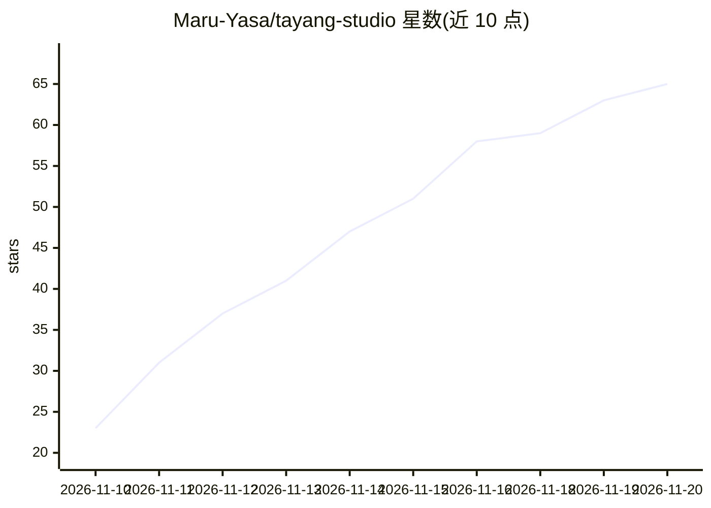

# Maru-Yasa/tayang-studio

⭐ 65 · TypeScript · 推送 2026-11-16 · [GitHub](https://github.com/Maru-Yasa/tayang-studio) · [官网](https://studio.tayang.app) · 个人维护

**帮创作者用自有 AI agent 自动制作动态视频的桌面应用**

面向（印尼）创作者的开源桌面应用（Tauri + React）：选题材、写脚本并处理提示，由用户已有的 AI agent（Claude Code、opencode、Gemini CLI、Codex、Antigravity CLI 或任意 ACP agent）经 ACP 协议执行实际生成，应用自身不含 AI。提供视频管理、内置/复制样式（可从 TikTok/Reels/YouTube 链接复制）、定时 Autopilot 与日历视图；数据存本地 SQLite，可选的闭源 API 仅提供登录、付费计划与在线样式。命令执行默认需用户批准。支持 macOS/Linux/Windows 安装脚本、deb/rpm/AppImage 及源码运行（Node 22+、pnpm、Rust）。

## 筛选速览

| 维度 | 判定 | 备注 |
|---|---|---|
| AI 角色 | `ai-native` | 本体是模型或模型工具 |
| 许可风险 | `none` | — |
| 部署形态 | `library` | 以包/库形式分发 |
| 模型依赖 | — | README 未给出锁定关系 |
| 硬件要求 | — | 无带数字的原话,不猜 |
| 安装摩擦 | `low` | 无编译、无系统依赖或容器化 |
| 成熟度 | — | 结构信号不足 |

## 能力要点

- 自身无 AI，全部生成经 ACP 由用户已有 agent 完成
- Autopilot 按计划自动产出视频，样式可从视频链接复制
- 数据存本地 SQLite，agent 命令执行默认需用户批准
- macOS/Linux/Windows 一键安装脚本，安装后自更新

## 适用场景

- 不写提示词就让 AI agent 批量产出动态视频
- 按日历排期自动发布/备货短视频内容
- 从喜欢的短视频复制风格应用到新项目

## 场景标签

`视频生成` · 领域:内容生成

## 证据(README 行号)

> L3: Tayang Studio is a free, open-source desktop app that helps Indonesian creators make motion videos without writing p
> L67: - The agent runs over ACP. Tayang has no AI of its own: every generation goes through the agent you already use.

## 星数曲线

2026-11-10 23 → 2026-11-20 65（+42）

---
*卡片 v1 · prompt 1.4 · 生成 2026-11-18 · 置信度 mid · 依据 README sha `92854c546e21` · [字段定义](../../DATASET.md)*
