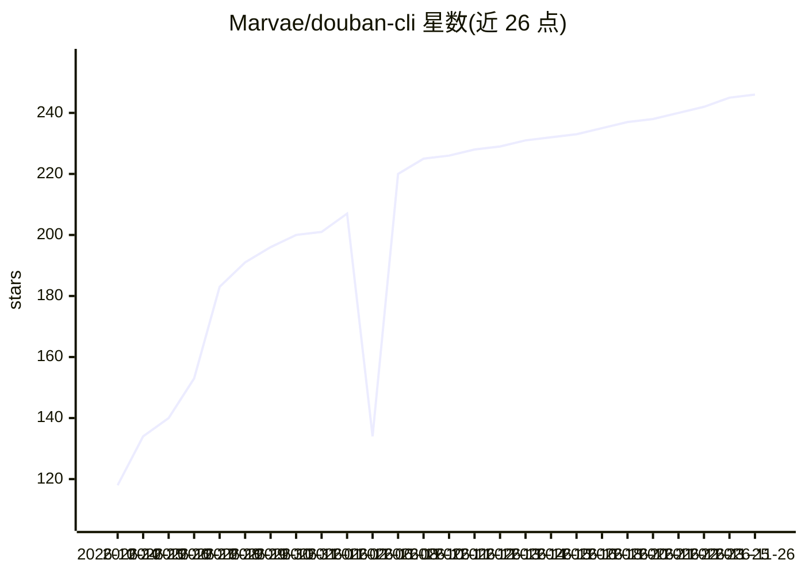

# Marvae/douban-cli

⭐ 246 · TypeScript · MIT · 推送 2026-11-24 · [GitHub](https://github.com/Marvae/douban-cli) · [官网](https://www.npmjs.com/package/@marvae24/douban-cli) · 个人维护 · 中文 README

**豆瓣命令行工具与 AI Agent Skill，查影书并备份标记记录**

提供豆瓣数据的命令行查询与账号记录管理：查询电影、剧集、图书的评分、短评、榜单和相似推荐（无需登录），一条命令导出观影/读书记录为 JSON、CSV 或 Markdown，并支持标记、评分、写短评（登录后，改动前预览、按 ISBN 核对、保留原有评分标签）。同时以 Agent Skill 形式接入支持 Agent Skills 的 AI agent，用自然语言完成上述操作。npm 分发，需 Node.js 22.13+，仅 2 个依赖，无 API key。非官方工具，需控制请求频率。

## 筛选速览

| 维度 | 判定 | 备注 |
|---|---|---|
| AI 角色 | `ai-enhanced` | 去掉 AI 部分产品仍成立 |
| 许可风险 | `permissive` | MIT |
| 部署形态 | `library` | 以包/库形式分发 |
| 模型依赖 | — | README 未给出锁定关系 |
| 硬件要求 | — | 无带数字的原话,不猜 |
| 安装摩擦 | `low` | 无编译、无系统依赖或容器化 |
| 成熟度 | — | 结构信号不足 |

## 能力要点

- 查询豆瓣影书评分、榜单、相似推荐与播放平台，公开查询不用登录
- 一条命令导出观影/读书记录为 JSON、CSV 或 Markdown，含评分与短评
- 以 Agent Skill 接入 AI agent，改动账号前先预览并按 ISBN 核对
- npx 直接运行，2 个依赖，不需要 API key

## 适用场景

- 备份导出豆瓣观影和读书记录为本地文件
- 在终端快速查电影剧集图书评分和榜单
- 让 AI agent 帮我标记看过、评分、写短评
- 把微信读书读完的书按 ISBN 同步标记到豆瓣

## 场景标签

 · 领域:生活服务/命令行工具

## 证据(README 行号)

> L8: 在终端和 AI 里用豆瓣：查电影、剧集、图书和 Top250，一条命令导出备份你的豆瓣观影和读书记录，让 AI 放心地帮你标记、评分、写短评。
> L20: - 🤖 **交给 AI**：装上 Skill，直接说“今晚看什么”“用 ISBN 把这本书标成读过，评 5 星”。改动账号前会先给你看预览；同一书名有多个版本时按 ISBN 核对。
> L35: ## 在 AI agent 里使用

## 星数曲线

2026-10-24 118 → 2026-11-26 246（+128）

---
*卡片 v1 · prompt 1.4 · 生成 2026-11-25 · 置信度 high · 依据 README sha `1bf50035ee32` · [字段定义](../../DATASET.md)*
