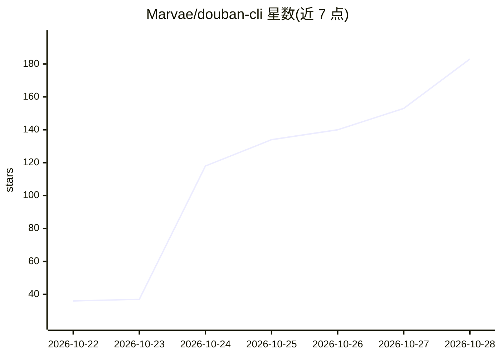

# Marvae/douban-cli

⭐ 183 · TypeScript · MIT · 推送 2026-10-27 · [GitHub](https://github.com/Marvae/douban-cli) · [官网](https://www.npmjs.com/package/@marvae24/douban-cli) · 个人维护 · 中文 README

**豆瓣命令行工具 + AI Agent Skill：查影书、备份记录、AI 代标记评分**

面向豆瓣用户的终端工具：无需登录即可查询电影、剧集、图书评分与 Top250、热映、口碑榜、豆列；登录后可导出看过/想看/读过的记录（含评分、短评、仅自己可见条目）为 JSON、CSV 或 Markdown，并支持标记、评分、写短评等修改操作。同时以 SKILL.md 格式提供 AI Agent Skill，让 agent 以自然语言代为查询与修改，改动前先展示预览，改完读回核对。仅 2 个依赖、无需 API key，Node.js 22.13+ 环境下可 npx 直接运行。非官方工具，Cookie 加密存本机且 30 天失效。

## 筛选速览

| 维度 | 判定 | 备注 |
|---|---|---|
| AI 角色 | `ai-enhanced` | 去掉 AI 部分产品仍成立 |
| 许可风险 | `permissive` | MIT |
| 部署形态 | `library` | 以包/库形式分发 |
| 模型依赖 | — | README 未给出锁定关系 |
| 硬件要求 | — | 无带数字的原话,不猜 |
| 安装摩擦 | `low` | 无编译、无系统依赖或容器化 |
| 成熟度 | — | 结构信号不足 |

## 能力要点

- 一条命令导出观影/读书记录为 JSON、CSV、Markdown
- AI Agent Skill：自然语言查询与标记/评分，改动前预览、改后读回核对
- 无需登录的公开查询（Top250、热映、口碑榜、ISBN 查书）
- 仅 2 个依赖、无需 API key，npx 直接运行

## 适用场景

- 备份和导出自己的豆瓣观影、读书记录
- 让 AI 助手帮我标记看过、评分、写短评
- 在终端快速查电影/图书评分与相似推荐
- 把微信读书读完的书按 ISBN 同步标记到豆瓣

## 场景标签

 · 领域:生活记录/媒体数据工具

## 证据(README 行号)

> L8: 在终端和 AI 里用豆瓣：查电影、剧集、图书和 Top250，一条命令导出备份你的豆瓣观影和读书记录，让 AI 放心地帮你标记、评分、写短评。
> L20: - 🤖 **交给 AI**：装上 Skill，直接说“今晚看什么”“把《三体》标成读过，评 5 星”。改动账号前会先给你看预览。
> L46: Skill 会在需要时帮你装好 CLI。用到账号功能时，需要你在自己的终端里运行一次 `douban login`。

## 星数曲线

2026-10-22 36 → 2026-10-28 183（+147）

---
*卡片 v1 · prompt 1.4 · 生成 2026-10-23 · 置信度 high · 依据 README sha `f8f0e96d628b` · [字段定义](../../DATASET.md)*
