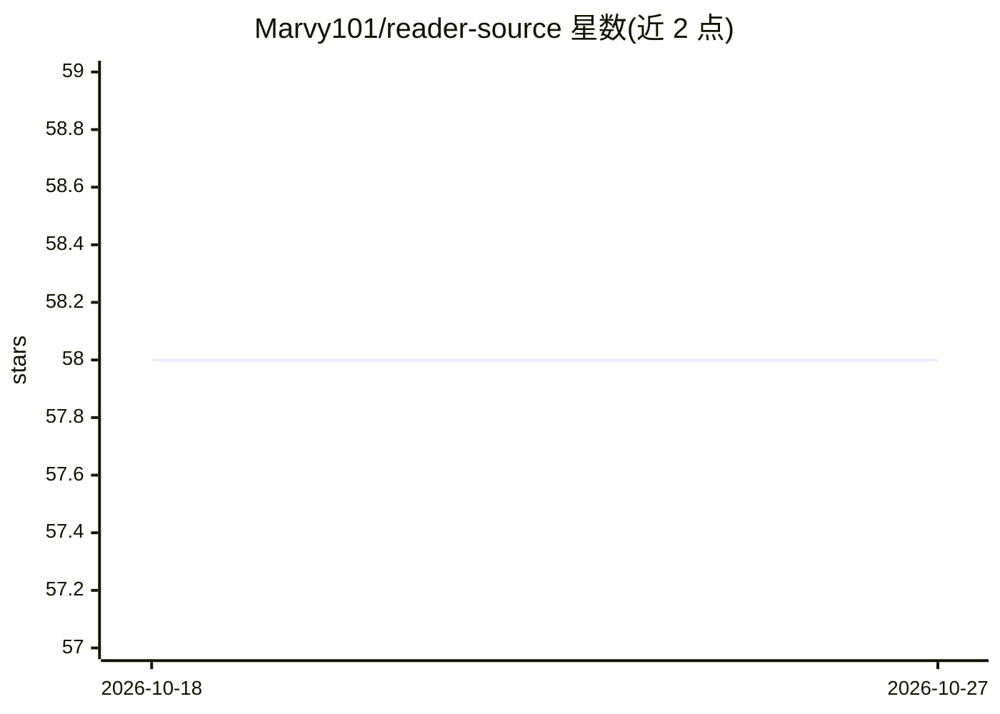

# Marvy101/reader-source

⭐ 58 · Swift · MIT · 推送 2026-10-25 · [GitHub](https://github.com/Marvy101/reader-source) · [官网](https://reader.marvy101.com) · 个人维护

**macOS 原生 AI 阅读工作台：读书、笔记与全书对话**

Swift/SwiftUI 构建的开源 macOS 原生阅读应用，导入 PDF/EPUB/TXT 后可高亮、批注、跨库搜索，并与选段、当前页、读到位置或整本书进行 AI 对话，支持改写难懂段落。本地优先：图书馆、进度、标注与对话存于本地 SQLite，无需账号或后端即可使用；Supabase 同步与 AI 功能为可选，需自建 Supabase/Vercel 后端。构建需 macOS 15 与 Xcode 16，或从官网下载安装包。

## 筛选速览

| 维度 | 判定 | 备注 |
|---|---|---|
| AI 角色 | `ai-enhanced` | 去掉 AI 部分产品仍成立 |
| 许可风险 | `permissive` | MIT |
| 部署形态 | `None` |  |
| 模型依赖 | — | README 未给出锁定关系 |
| 硬件要求 | — | 无带数字的原话,不猜 |
| 安装摩擦 | `medium` | 含编译或系统依赖之一 |
| 成熟度 | — | 结构信号不足 |

## 能力要点

- 按选段/当前页/读到位置/整本书的上下文 AI 对话
- 本地优先：阅读、搜索、标注不依赖云端，数据存 SQLite
- 自研 EPUB/TXT 解析与 PDFKit 双格式适配的 Reader Core
- 可选私有云：经自有 Supabase/Vercel 同步原文与标注

## 适用场景

- 在 Mac 上统一管理并批注 PDF/EPUB/TXT 书籍
- 阅读时向 AI 提问或改写难懂段落
- 本地保存阅读进度、高亮与对话，不依赖云服务

## 场景标签

`知识库管理` `文档问答` · 领域:知识与检索

## 证据(README 行号)

> L15: The library and reading experience are local-first. Books, progress,
> L25: - **Contextual AI:** chat about a selected passage, the current page, the book
> L37: - **Local-first failure model:** opening, reading, searching, highlighting, and

## 星数曲线

2026-10-18 58 → 2026-10-27 58（+0）

---
*卡片 v1 · prompt 1.4 · 生成 2026-10-24 · 置信度 high · 依据 README sha `7a778ae6fbd5` · [字段定义](../../DATASET.md)*
