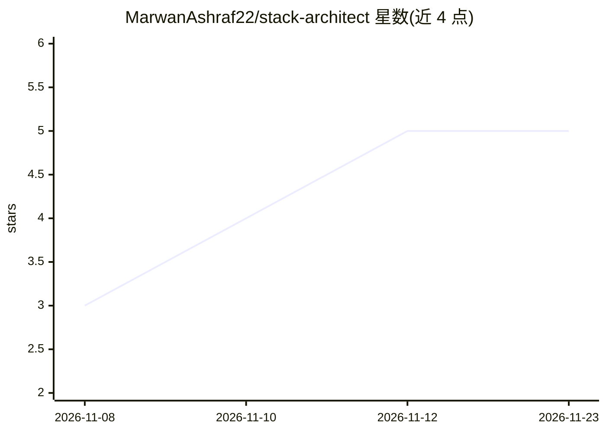

# MarwanAshraf22/stack-architect

⭐ 5 · Shell · MIT · 推送 2026-10-31 · [GitHub](https://github.com/MarwanAshraf22/stack-architect) · 个人维护

**开发者用 Claude 技能：逐层选定技术栈并生成决策记录**

面向在开工前需要选定技术栈的开发者的 Claude 技能：通过提问澄清需求，产出覆盖前端、后端、数据库、ORM、缓存、认证、托管、CI/CD、备份、监控、支付、邮件、存储、成本与扩展路径的 Stack Decision Record，每项附带理由与备选方案。内置按项目类型的默认技术栈文件可自行编辑，并通过脚本核对依赖版本的新鲜度。安装方式包括 Claude Code 插件、git clone 手动放置及 Claude.ai 上传 .skill 文件。

## 筛选速览

| 维度 | 判定 | 备注 |
|---|---|---|
| AI 角色 | `ai-native` | 本体是模型或模型工具 |
| 许可风险 | `permissive` | MIT |
| 部署形态 | `self-host` | docker 或自建部署 |
| 模型依赖 | locked-api |  |
| 硬件要求 | — | 无带数字的原话,不猜 |
| 安装摩擦 | `low` | 无编译、无系统依赖或容器化 |
| 成熟度 | — | 结构信号不足 |

## 能力要点

- 生成含理由与备选方案的 Stack Decision Record
- references/00-house-defaults.md 支持自定义团队默认技术栈
- scripts/check_versions.sh 在推荐前核对依赖版本
- 附带 scaffold 命令输出 Dockerfile、docker-compose、CI workflow 等初始化文件

## 适用场景

- 开新项目前确定数据库、认证、托管等各层选型
- 为团队沉淀统一的技术栈默认标准
- 让 Claude 在选型时核对依赖库当前版本

## 场景标签

`AI 助手` · 领域:对话与助手

## 证据(README 行号)

> L5: A Claude skill that asks the few questions that matter, then hands you a complete **Stack Decision Record**: fronten
> L20: The most expensive mistakes in software happen before coding starts: the wrong database, hand-rolled auth, a databa

## 星数曲线

2026-11-08 3 → 2026-11-23 5（+2）

---
*卡片 v1 · prompt 1.4 · 生成 2026-11-21 · 置信度 mid · 依据 README sha `0757b59a99df` · [字段定义](../../DATASET.md)*
