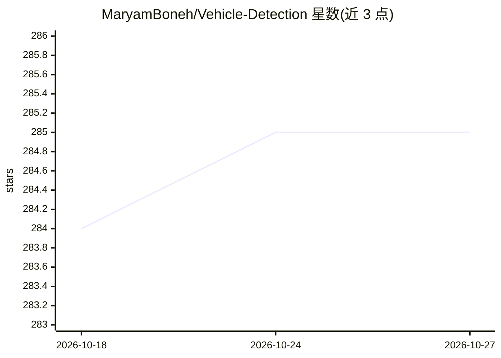

# MaryamBoneh/Vehicle-Detection

⭐ 285 · Python · GPL-3.0 · 推送 2026-09-17 · [GitHub](https://github.com/MaryamBoneh/Vehicle-Detection) · 个人维护

**用 YOLOv5 微调实现车辆检测与计数的训练检测项目**

基于 YOLOv5 的车辆检测项目：在自定义车辆数据集上对预训练 yolov5m 模型进行微调（train.py，支持指定图像尺寸、batch、epoch），再用 detect.py 对图像做车辆检测推理。数据集按 70/20/10 划分训练/验证/测试，需向作者邮件索取。README 提供安装命令与示例训练/检测命令，仓库附带已训练 128 epoch 的权重文件可直接使用。训练监控依赖 wandb 记录 mAP、loss 与混淆矩阵等指标。

## 筛选速览

| 维度 | 判定 | 备注 |
|---|---|---|
| AI 角色 | `ai-native` | 本体是模型或模型工具 |
| 许可风险 | `viral` | GPL-3.0 |
| 部署形态 | `library` | 以包/库形式分发 |
| 模型依赖 | — | README 未给出锁定关系 |
| 硬件要求 | — | 无带数字的原话,不猜 |
| 安装摩擦 | `low` | 无编译、无系统依赖或容器化 |
| 成熟度 | — | 结构信号不足 |

## 能力要点

- 基于 YOLOv5 预训练模型微调（yolov5m.pt）
- 提供 train.py 训练与 detect.py 检测流程
- 附带 128 epoch 训练所得权重文件，可跳过训练直接检测
- 通过 wandb 记录 mAP、loss、混淆矩阵等指标

## 适用场景

- 在自己的车辆图像数据集上微调 YOLOv5 做车辆检测
- 使用附带权重直接对测试图像进行车辆检测
- 学习 YOLOv5 自定义数据集训练流程

## 场景标签

`目标检测` · 领域:感知与多模态

## 证据(README 行号)

> L1: # Vehicle Detection
> L8: *(Train YOLO v5 on a Custom Dataset)*
> L48: python train.py --img 640 --batch 16 --epochs 50 --data dataset.yaml --weights yolov5m.pt
> L56: python detect.py --weights runs/train/exp12/weights/best.pt --source test_images/imtest13.JPG

## 星数曲线

2026-10-18 284 → 2026-10-27 285（+1）

---
*卡片 v1 · prompt 1.4 · 生成 2026-10-22 · 置信度 high · 依据 README sha `961d9baa9441` · [字段定义](../../DATASET.md)*
