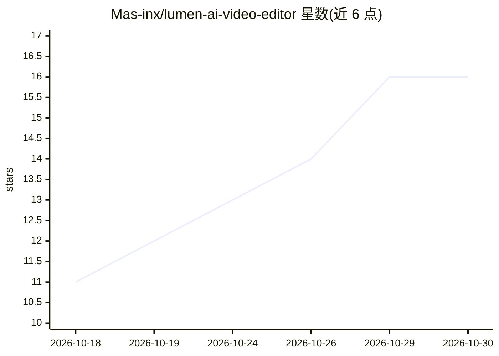

# Mas-inx/lumen-ai-video-editor

⭐ 16 · TypeScript · MIT · 推送 2026-10-15 · [GitHub](https://github.com/Mas-inx/lumen-ai-video-editor) · [官网](https://github.com/Mas-inx/lumen-ai-video-editor/releases/latest) · 组织维护

**Windows 桌面 AI 视频编辑器：AI 助手可看、听、剪辑时间线**

基于 Electron/React/TypeScript 的开源桌面视频编辑器，提供磁吸时间线、关键帧、3D 标题与转场、GPU 调色、多机位对齐、录屏等剪辑功能，支持 Windows 10/11。AI 层面：Copilot 可读取工程、监看整段剪辑、分轨测量响度并直接执行 133 个工具命令，每次编辑均为可撤销步骤；接入 Claude Code、Codex、Anthropic/OpenAI/Gemini/OpenRouter API key 或本地 Ollama/LM Studio，内置 MCP server 供任意 agent 驱动；设备端 Whisper（WebGPU/CPU）生成字幕。本地优先，媒体不上传。

## 筛选速览

| 维度 | 判定 | 备注 |
|---|---|---|
| AI 角色 | `ai-enhanced` | 去掉 AI 部分产品仍成立 |
| 许可风险 | `permissive` | MIT |
| 部署形态 | `desktop` | 安装包/桌面程序 |
| 模型依赖 | local-ok | 支持本地模型 |
| 硬件要求 | — | 无带数字的原话,不猜 |
| 安装摩擦 | `low` | 无编译、无系统依赖或容器化 |
| 成熟度 | — | 结构信号不足 |

## 能力要点

- 133 个 AI 工具，Copilot 可监看剪辑并执行可撤销的编辑
- 支持 Claude Code/Codex 或 API key（Anthropic/OpenAI/Gemini/OpenRouter）及本地 Ollama/LM Studio
- 设备端 Whisper 字幕（WebGPU/CPU），本地优先、媒体不上传
- 内置 MCP server 与 client，任意 agent 可驱动编辑器

## 适用场景

- 用自然语言让 AI 剪辑：去停顿、加字幕、做竖版短视频
- 本地转录与字幕生成，不上传素材
- 通过 MCP 接入自己的 agent 自动化视频剪辑流程

## 场景标签

`AI 助手` `图像视频处理` `语音识别` · 领域:对话与助手

## 证据(README 行号)

> L9: Lumen is a desktop video editor where the AI isn't a chatbot bolted onto a timeline. It watches your edit frame by f
> L31: - **An AI that edits, not just chats.** Every edit in Lumen is a typed command, and the AI gets all of them — plus 
> L34: - **Local-first.** Media is edited in place and never uploaded. Speech-to-text runs on your GPU with Whisper. No ac

## 星数曲线

2026-10-18 11 → 2026-10-30 16（+5）

---
*卡片 v1 · prompt 1.4 · 生成 2026-10-30 · 置信度 mid · 依据 README sha `c8daa39d2975` · [字段定义](../../DATASET.md)*
