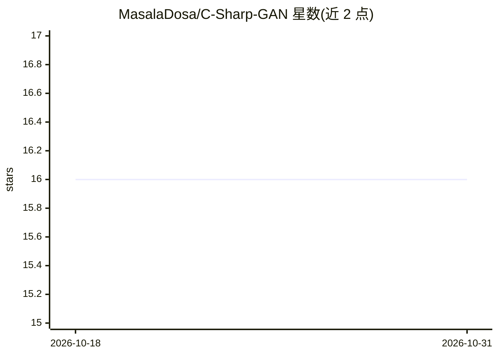

# MasalaDosa/C-Sharp-GAN

⭐ 16 · C# · 推送 2026-10-16 · [GitHub](https://github.com/MasalaDosa/C-Sharp-GAN) · 个人维护

**纯 C# 实现的 GAN：学习生成 MNIST 手写数字**

用 C#/.NET Core 从零实现的生成对抗网络，训练目标是生成伪造的 MNIST 数字。运行程序后可选择训练的数字范围（如仅 3 和 4），或回车训练全部数字（作者经验为每轮至少 2 小时）。每个 epoch 结束时按启动时的本地时间戳向文件夹写入示例生成图像。README 引用了撰写该项目时参考的 C# 神经网络教程 URL，并展示了 5 个 epoch 后的示例结果图。以源码程序形式提供，无第三方深度学习框架依赖说明。

## 筛选速览

| 维度 | 判定 | 备注 |
|---|---|---|
| AI 角色 | `ai-native` | 本体是模型或模型工具 |
| 许可风险 | `none` | — |
| 部署形态 | `None` |  |
| 模型依赖 | — | README 未给出锁定关系 |
| 硬件要求 | — | 无带数字的原话,不猜 |
| 安装摩擦 | `low` | 无编译、无系统依赖或容器化 |
| 成熟度 | — | 结构信号不足 |

## 能力要点

- 完全用 C# 编写的 GAN 实现
- 可指定训练的 MNIST 数字范围（如 3、4）
- 每轮结束输出示例生成图像到本地文件夹

## 适用场景

- 学习 GAN 的 C# 实现方式
- 生成 MNIST 风格的伪数字图像做实验

## 场景标签

`图像生成` · 领域:内容生成

## 证据(README 行号)

> L1: A simple Generative Adversarial Network (GAN) written entirely in c#.
> L3: This GAN can (slowly) learn to produce fake MNIST digits.

## 星数曲线

2026-10-18 16 → 2026-10-31 16（+0）

---
*卡片 v1 · prompt 1.4 · 生成 2026-10-30 · 置信度 high · 依据 README sha `eaabb5adb38a` · [字段定义](../../DATASET.md)*
