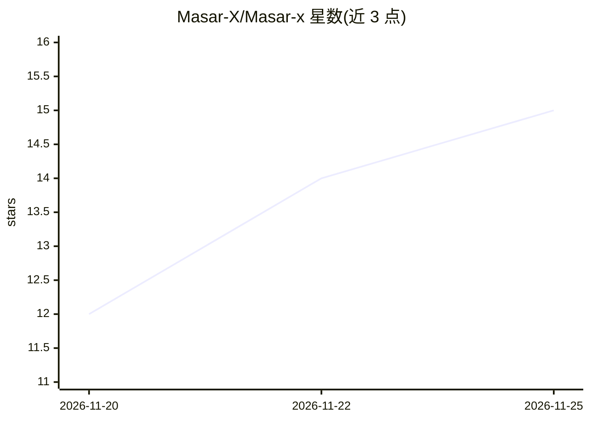

# Masar-X/Masar-x

⭐ 15 · TypeScript · AGPL-3.0 · 推送 2026-11-23 · [GitHub](https://github.com/Masar-X/Masar-x) · [官网](https://masarx.vercel.app) · 组织维护 · 中文 README

**面向大学生的双语 AI 学习平台：资料、测验与 AI 辅导**

面向大学学生的学习平台，提供学习摘要、互动课程、测验、成绩跟踪与考试资料库，内置 AI 辅助功能，默认支持英文/阿拉伯文双语与 RTL。技术栈为 Next.js 16 + Supabase + Electron + Expo 的 pnpm monorepo，Web、桌面、移动三端共享同一后端与 shared 包。AI 与 service-role 密钥全部保留在服务端，配合 RLS、速率限制与 CI 强制检查。桌面版自动更新，Web 版已上线生产，桌面与移动端标注为开发中。

## 筛选速览

| 维度 | 判定 | 备注 |
|---|---|---|
| AI 角色 | `ai-native` | 本体是模型或模型工具 |
| 许可风险 | `viral` | AGPL-3.0 |
| 部署形态 | `desktop` | 安装包/桌面程序 |
| 模型依赖 | — | README 未给出锁定关系 |
| 硬件要求 | — | 无带数字的原话,不猜 |
| 安装摩擦 | `low` | 无编译、无系统依赖或容器化 |
| 成熟度 | — | 结构信号不足 |

## 能力要点

- Web/桌面/移动三端共享一套 Supabase 后端与 shared 包
- AI 密钥仅存服务端，客户端不接触 provider keys
- 测验评分由服务端权威执行，防止客户端伪造分数
- 英/阿双语本地化，next-intl + RTL 支持

## 适用场景

- 大学生查阅课程摘要与考试资料库
- 通过平台完成学科测验并跟踪成绩
- 使用 AI 辅助获取学习答疑

## 场景标签

`RAG` `文档问答` · 领域:知识与检索

## 证据(README 行号)

> L7: Study summaries, interactive courses, quizzes, AI-powered assistance, and complete learning management — bilingual (
> L23: - **AI-powered assistance** — study help served through a hardened server-side boundary (provider keys never reach 
> L25: - **Cross-platform** — one Supabase backend and one shared package powering web, desktop, and mobile apps.

## 星数曲线

2026-11-20 12 → 2026-11-25 15（+3）

---
*卡片 v1 · prompt 1.4 · 生成 2026-11-20 · 置信度 mid · 依据 README sha `fcb7ee330a81` · [字段定义](../../DATASET.md)*
