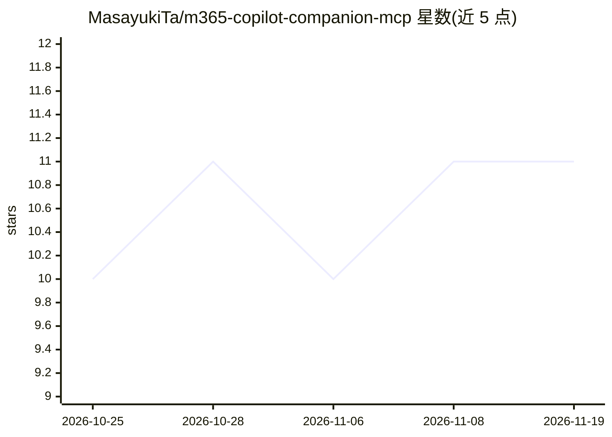

# MasayukiTa/m365-copilot-companion-mcp

⭐ 11 · Python · MIT · 推送 2026-11-18 · [GitHub](https://github.com/MasayukiTa/m365-copilot-companion-mcp) · 个人维护

**让 M365 Copilot 操作本地 PC 的个人用 MCP 服务器**

在本机运行的小型 Python MCP 服务器，通过 Dev Tunnel 暴露给 Copilot Studio 代理，为 Microsoft 365 Copilot 提供文件读写、Python 执行、Excel/Office 生成、OCR、内网 SQL（ODBC）等本地工具；另经 relay/fleet 驱动 Edge 上的 Copilot Web UI 实现无人值守并行任务。提供 quickstart.bat 七步引导与 doctor.bat 诊断，要求 Windows 10/11、M365 Copilot 许可与可访问 Copilot Studio 的职场账户，声明无需额外 API 契约与管理员权限。

## 筛选速览

| 维度 | 判定 | 备注 |
|---|---|---|
| AI 角色 | `ai-ecosystem` | LLM/agent 周边工具 |
| 许可风险 | `permissive` | MIT |
| 部署形态 | `desktop` | 安装包/桌面程序 |
| 模型依赖 | — | README 未给出锁定关系 |
| 硬件要求 | — | 无带数字的原话,不猜 |
| 安装摩擦 | `low` | 无编译、无系统依赖或容器化 |
| 成熟度 | — | 结构信号不足 |

## 能力要点

- 本地 MCP 服务器提供文件、Python、Office、OCR、ODBC 数据库等工具
- 支持连接器与无连接器两种工具接入路径
- fleet 机制支持多任务并行无人自走，配 FleetCockpit 监控窗口
- Skill 机制支持创建、导入、审批复用工作方法，兼容 Claude 格式目录

## 适用场景

- 让 M365 Copilot 直接读写整理本机文件并生成 Office 文档
- 在保留 Windows 认证的前提下让 Copilot 查询内部 SQL 数据库
- 将多条任务并行交给 Copilot 无人值守执行并监控

## 场景标签

`工作流自动化` `浏览器自动化` · 领域:效率与自动化

## 证据(README 行号)

> L6: M365 Copilot を、**あなたの PC を操作できる自律エージェント**にするツールです。
> L37: - このツールはあなたのノート PC で動く小さなサーバーを Copilot に繋ぎ、**ファイル操作・Python 実行・Excel・OCR・社内 DB**といった"手"を与えます。
> L235: - あなたの PC で小さな Python サーバー（MCP サーバー）が動き、ファイルや Python 実行などの「手」を提供します。

## 星数曲线

2026-10-25 10 → 2026-11-19 11（+1）

---
*卡片 v1 · prompt 1.4 · 生成 2026-11-19 · 置信度 high · 依据 README sha `1126b54c00f2` · [字段定义](../../DATASET.md)*
