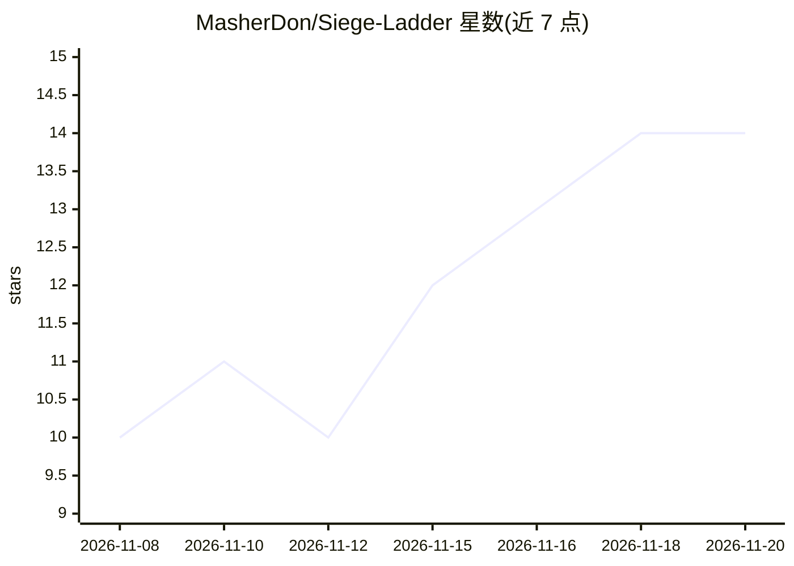

# MasherDon/Siege-Ladder

⭐ 14 · Python · MIT-0 · 推送 2026-11-09 · [GitHub](https://github.com/MasherDon/Siege-Ladder) · 个人维护

**让 DeepSeek-V4.1-Flash 在 16 GB 显卡 + NVMe 流式专家上本地运行**

一份研究记录与补丁集：通过修改 llama.cpp 实现 MoE 专家从 NVMe 分层流式读取（VRAM 缓存层、固定内存 RAM 层、NVMe 读取层），配合权重组装脚本、基准测试与调优笔记，在单张 16 GB 消费级 GPU + 64 GB RAM 的 Windows PC 上运行 DeepSeek-V4.1-Flash-1017，目标是最长 1M token 长上下文的可用速度。作者声明为进行中的个人项目，部分组件仅限 Windows，不承诺支持。

## 筛选速览

| 维度 | 判定 | 备注 |
|---|---|---|
| AI 角色 | `ai-native` | 本体是模型或模型工具 |
| 许可风险 | `permissive` | MIT-0 |
| 部署形态 | `None` |  |
| 模型依赖 | local-ok | 支持本地模型 |
| 硬件要求 | — | 无带数字的原话,不猜 |
| 安装摩擦 | `high` | 编译与系统依赖俱全 |
| 成熟度 | `idea` | |

## 能力要点

- 三层内存阶梯（VRAM/RAM/NVMe）流式加载 MoE 专家权重
- lens 文件预测即将用到的专家并提前预读
- YoCo 截断与 layer-major prefill 等长上下文优化手段
- 附带可复现的权重组装脚本（tools/assemble.py）与基准数据

## 适用场景

- 在显存不足以容纳整个 MoE 模型的 PC 上本地运行大模型
- 研究 MoE 专家权重的分层加载与流式推理策略
- 复现并对比不同的量化构建（og/cd/qd）的速度与质量数据

## 场景标签

`推理引擎` `模型量化` · 领域:训练与推理

## 证据(README 行号)

> L11: > **Work in progress.** This is a research log with patches, not a finished engine: rough edges, some Windows-only
> L40: DeepSeek-V4.1-Flash-1017 does not fit in RAM + VRAM. We use two builds with the same Q5_K dense part from
> L142: 1. **A three-step ladder for the experts:** ~23 per layer cached in VRAM, a pinned RAM tier (43–46 GiB), unbuffere

## 星数曲线

2026-11-08 10 → 2026-11-20 14（+4）

---
*卡片 v1 · prompt 1.4 · 生成 2026-11-18 · 置信度 high · 依据 README sha `b8ed34597035` · [字段定义](../../DATASET.md)*
