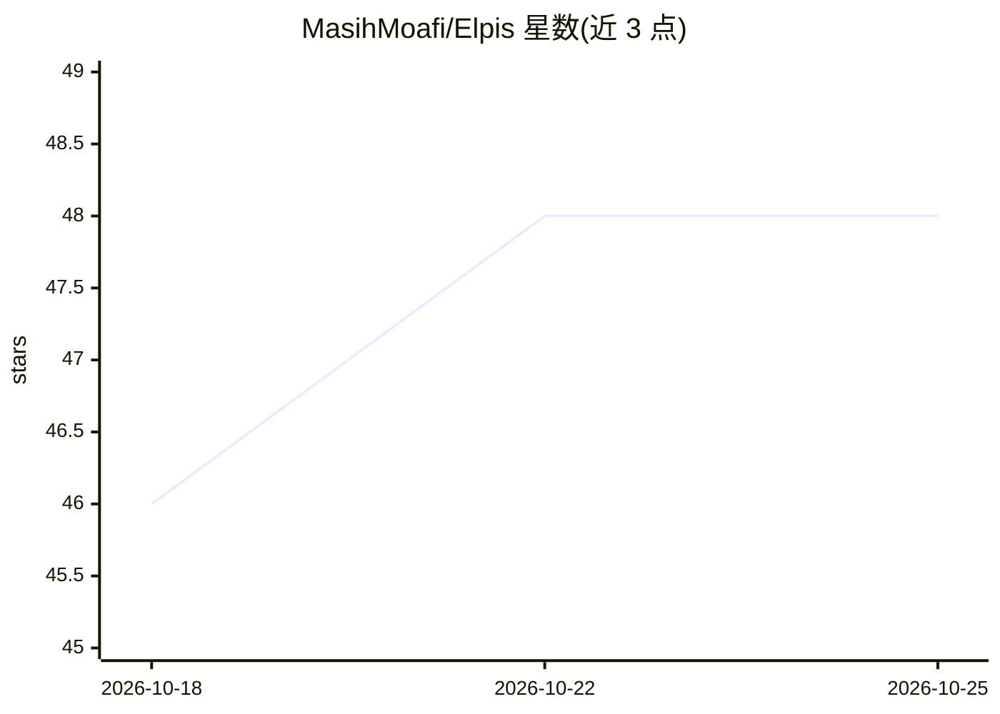

# MasihMoafi/Elpis

⭐ 48 · Rust · Apache-2.0 · 推送 2026-10-24 · [GitHub](https://github.com/MasihMoafi/Elpis) · [官网](https://elpis.masihmoafi.com/) · 个人维护

**Linux 编码 agent 环境：基于 Codex CLI 的上下文可控 TUI**

构建于 OpenAI Codex CLI 之上的 Linux 编码 agent 环境，保留其终端执行基础，增加 Context Ledger（控制被纳入的工作区指令、选定文件与记忆）、跨会话的持久知识与工作区检查点、Smart Prune（实验性，默认关闭）与本地 dashboard。多 agent 层级可查看，支持实验性 work graph。本地网关支持 Anthropic、Gemini、OpenRouter 与 OpenAI 提供方。仅提供 Linux x86_64 二进制与 Debian 包，macOS/Windows 不含；不捆绑模型权重、检索或语音引擎。

## 筛选速览

| 维度 | 判定 | 备注 |
|---|---|---|
| AI 角色 | `ai-ecosystem` | LLM/agent 周边工具 |
| 许可风险 | `permissive` | Apache-2.0 |
| 部署形态 | `None` |  |
| 模型依赖 | locked-api |  |
| 硬件要求 | — | 无带数字的原话,不猜 |
| 安装摩擦 | `low` | 无编译、无系统依赖或容器化 |
| 成熟度 | `idea` | |

## 能力要点

- Context Ledger 控制并展示被纳入的指令、文件与记忆
- 代理通过受保护本地工具显式保存持久知识与工作区检查点
- 本地网关支持 Anthropic、Gemini、OpenRouter 与 OpenAI 多提供方
- 多 agent 层级视图与实验性 work graph（默认关闭）

## 适用场景

- 在 Linux 终端运行编码 agent 并审计其上下文来源
- 跨会话保留工作区检查点与持久记忆
- 在同一环境中切换不同模型提供方

## 场景标签

`编码 Agent` `模型网关` · 领域:Agent 开发

## 证据(README 行号)

> L3: Elpis is a Linux coding-agent environment built on OpenAI's Codex CLI. It keeps the execution and terminal foundatio
> L39: - `/model` and `--provider` select providers; the local gateway supports Anthropic, Gemini and OpenRouter paths alo

## 星数曲线

2026-10-18 46 → 2026-10-25 48（+2）

---
*卡片 v1 · prompt 1.4 · 生成 2026-10-25 · 置信度 high · 依据 README sha `af756d999273` · [字段定义](../../DATASET.md)*
