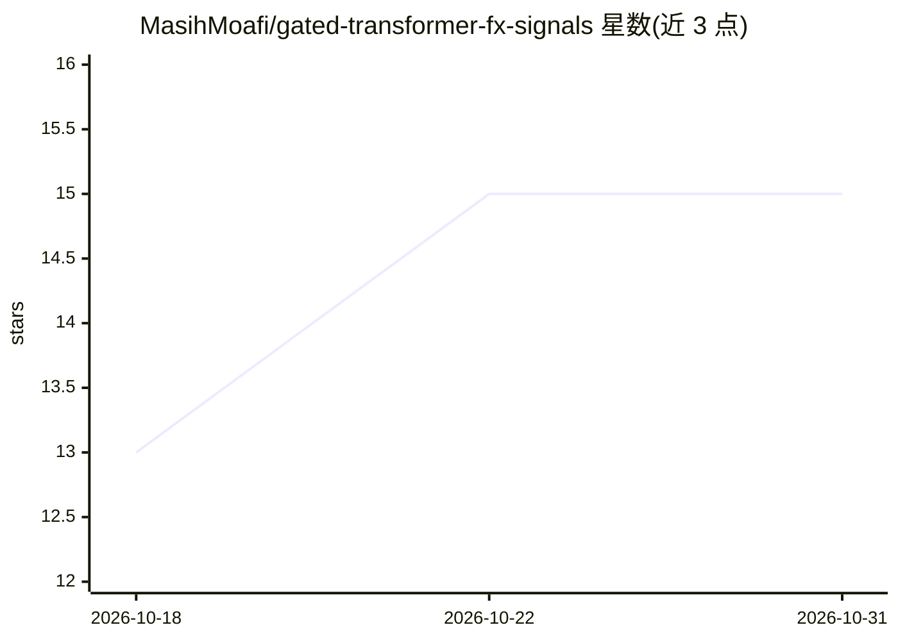

# MasihMoafi/gated-transformer-fx-signals

⭐ 15 · Python · MIT · 推送 2026-07-23 · [GitHub](https://github.com/MasihMoafi/gated-transformer-fx-signals) · 个人维护

**实验性 EUR/USD 信号预测研究管线（双塔门控 Transformer）**

个人研究性质的 EUR/USD 信号预测与回测评估管线：核心为双塔门控 Transformer 网络（GTN），配合数据准备脚本（data_pipeline/）、训练脚本（model/gtn_dual_tower.py）与回测评估工具（backtest_eval/）。采用 TP/SL-hit-first 标签、次根开盘价入场修正、时间顺序切分与类别敏感损失；当前记录的最高综合得分为 GTN 0.36、LightGBM 基线 0.37（跨次不稳定）。README 明确声明不含可分发数据集、未验证实盘盈利，离线得分到 MT5 实盘 P&L 的映射未解决；计划中的下一步是滚动前推验证。

## 筛选速览

| 维度 | 判定 | 备注 |
|---|---|---|
| AI 角色 | `ai-native` | 本体是模型或模型工具 |
| 许可风险 | `permissive` | MIT |
| 部署形态 | `library` | 以包/库形式分发 |
| 模型依赖 | — | README 未给出锁定关系 |
| 硬件要求 | — | 无带数字的原话,不猜 |
| 安装摩擦 | `low` | 无编译、无系统依赖或容器化 |
| 成熟度 | `idea` | |

## 能力要点

- 双塔门控 Transformer（GTN）训练与时间切分评估路径
- TP/SL-hit-first 标签与次根开盘价入场修正
- 综合得分公式惩罚买卖单侧精度失衡（GTN 0.36 / LightGBM 0.37）
- README 明确列举不支持的主张（实盘盈利、未来泛化、可分发数据集）

## 适用场景

- 复现 EUR/USD 信号分类实验并对比 GTN 与树模型基线
- 研究离线分类指标与交易目标之间的差距
- 参考时间序列金融数据的防泄漏切分与标签设计实践

## 场景标签

`金融量化` · 领域:学习与行业

## 证据(README 行号)

> L2: type: experimental ML research pipeline for EUR/USD signal prediction and backtest evaluation
> L34: python model/gtn_dual_tower.py \
> L94: - Temporal splitting, feature engineering, class-sensitive training, and output artifact generation in the GTN path

## 星数曲线

2026-10-18 13 → 2026-10-31 15（+2）

---
*卡片 v1 · prompt 1.4 · 生成 2026-10-30 · 置信度 mid · 依据 README sha `f9ffe0d41cd7` · [字段定义](../../DATASET.md)*
