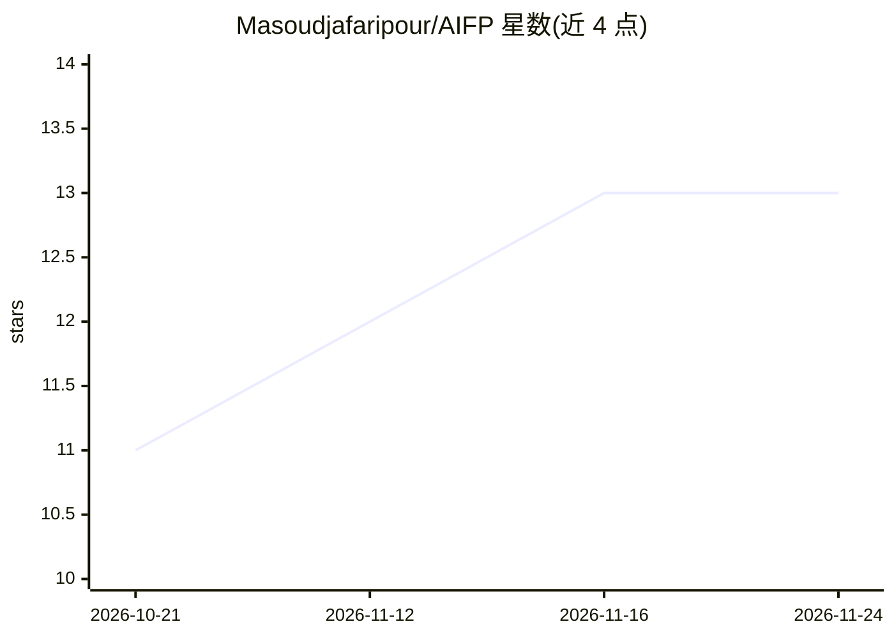

# Masoudjafaripour/AIFP

⭐ 13 · Python · MIT · 推送 2026-01-17 · [GitHub](https://github.com/Masoudjafaripour/AIFP) · [官网](https://openreview.net/pdf?id=M4rLudFbT2) · 个人维护

**LLM 迭代反馈路径规划框架：论文代码与数据集**

AAAI 2025 LM4Planning Workshop 论文配套仓库，提供 AIFP 框架的源代码与数据集：迭代提示 LLM 生成部分轨迹，进行碰撞检测，并通过 Receding Horizon Planning 迭代重规划，处理静态与动态障碍。基于 OpenAI GPT-4 API 实现，同时包含同一 2D 环境下的 A* 与 RRT 规划器，README 给出多环境下的实验成功率对比及定性可视化。仓库声明仍在更新中，需克隆源码运行。

## 筛选速览

| 维度 | 判定 | 备注 |
|---|---|---|
| AI 角色 | `ai-native` | 本体是模型或模型工具 |
| 许可风险 | `permissive` | MIT |
| 部署形态 | `None` |  |
| 模型依赖 | — | README 未给出锁定关系 |
| 硬件要求 | — | 无带数字的原话,不猜 |
| 安装摩擦 | `low` | 无编译、无系统依赖或容器化 |
| 成熟度 | — | 结构信号不足 |

## 能力要点

- 迭代反馈提示 LLM 生成轨迹并做碰撞检测
- RHP 滚动重规划处理静态与动态障碍
- 基于 OpenAI GPT-4 API 实现
- 附带 A*、RRT、Q-learning、MCTS 等对照规划器的可视化

## 适用场景

- 复现论文中 LLM 障碍感知路径规划实验
- 在 2D 环境中对比 LLM 与经典规划器表现
- 研究 HRI 场景下的 LLM 空间推理

## 场景标签

`科研工具` · 领域:学习与行业

## 证据(README 行号)

> L11: Planning is a critical component for intelligent agents, especially in **Human-Robot Interaction (HRI)**. Large Lan
> L20: ✅ **Fully implemented with OpenAI's GPT-4 API**

## 星数曲线

2026-10-21 11 → 2026-11-24 13（+2）

---
*卡片 v1 · prompt 1.4 · 生成 2026-11-18 · 置信度 high · 依据 README sha `12d8c5c6592c` · [字段定义](../../DATASET.md)*
