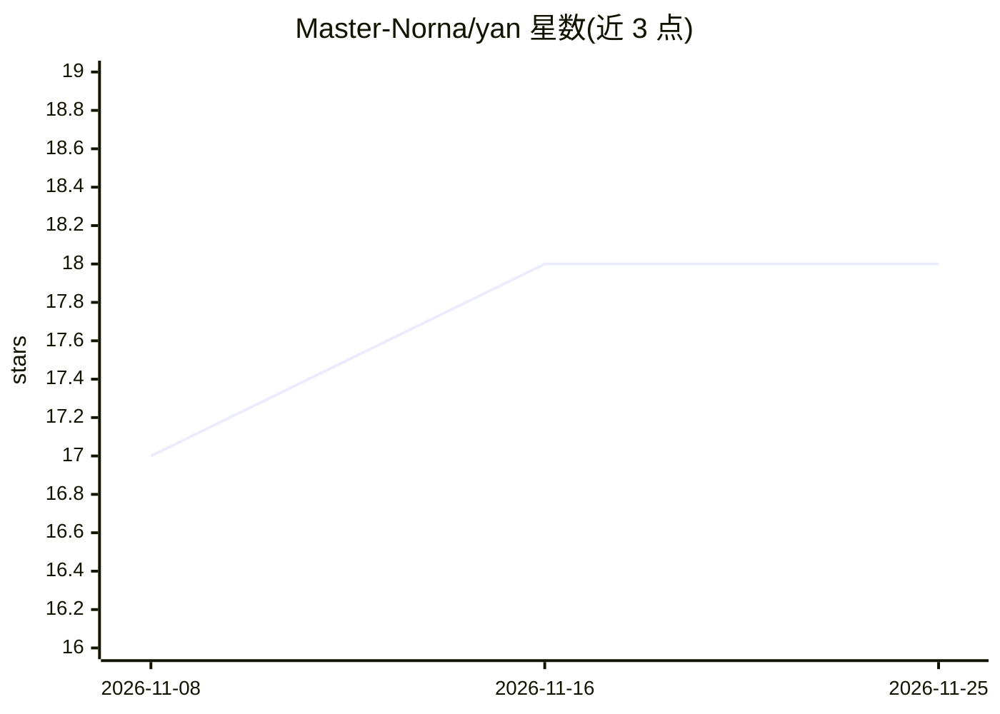

# Master-Norna/yan

⭐ 18 · JavaScript · Apache-2.0 · 推送 2026-11-24 · [GitHub](https://github.com/Master-Norna/yan) · 个人维护 · 中文 README

**本地运行的中文聊天与轻量 Agent 界面，模型自接**

面向终端用户的本机聊天与执事（Agent）应用：对话可绑定目录，让模型在其中读写文件、执行指令；支持旁注追问、长活验收（「意」）、后台挂起与定时唤醒、网页操作可视（游目）等机制。接口支持硅基流动、OpenAI 兼容、Anthropic 与 ChatGPT 订阅，无自有服务器，数据只落本机，需 Node.js 22。Windows 提供下载包，也可 npm start 从源码运行。

## 筛选速览

| 维度 | 判定 | 备注 |
|---|---|---|
| AI 角色 | `ai-native` | 本体是模型或模型工具 |
| 许可风险 | `permissive` | Apache-2.0 |
| 部署形态 | `desktop` | 安装包/桌面程序 |
| 模型依赖 | — | README 未给出锁定关系 |
| 硬件要求 | — | 无带数字的原话,不猜 |
| 安装摩擦 | `low` | 无编译、无系统依赖或容器化 |
| 成熟度 | — | 结构信号不足 |

## 能力要点

- 对话绑目录即在本地读写文件、执行指令的 Agent 模式
- 旁注追问、长活验收、挂起唤醒、网页操作可视化等交互机制
- 支持硅基流动/OpenAI 兼容/Anthropic/ChatGPT 订阅接入
- 本地运行无自有服务器，需 Node.js 22，指令分三档权限并有沙箱层

## 适用场景

- 在本机接自选模型进行聊天并让模型动手完成文件与指令任务
- 长任务跨对话推进并跟踪完成条件与凭据复核
- 让模型浏览网页并随时接手观察操作过程

## 场景标签

`聊天机器人` `浏览器自动化` `AI 助手` · 领域:效率与自动化

## 证据(README 行号)

> L11:  言 · 本地聊天与轻量执事界面
> L51: 卷宗与成品（PPT、Excel、PDF 做好就地预览）、答复里可交互的图表、差遣帮手分头做事、一答之内动过的文件可整个退回、预设与分组、MCP 与 Skill、跨对话的记忆。指令分三档权限，另有一层沙箱，规则拿不准的一步可交审查模

## 星数曲线

2026-11-08 17 → 2026-11-25 18（+1）

---
*卡片 v1 · prompt 1.4 · 生成 2026-11-18 · 置信度 high · 依据 README sha `6251a13188d9` · [字段定义](../../DATASET.md)*
