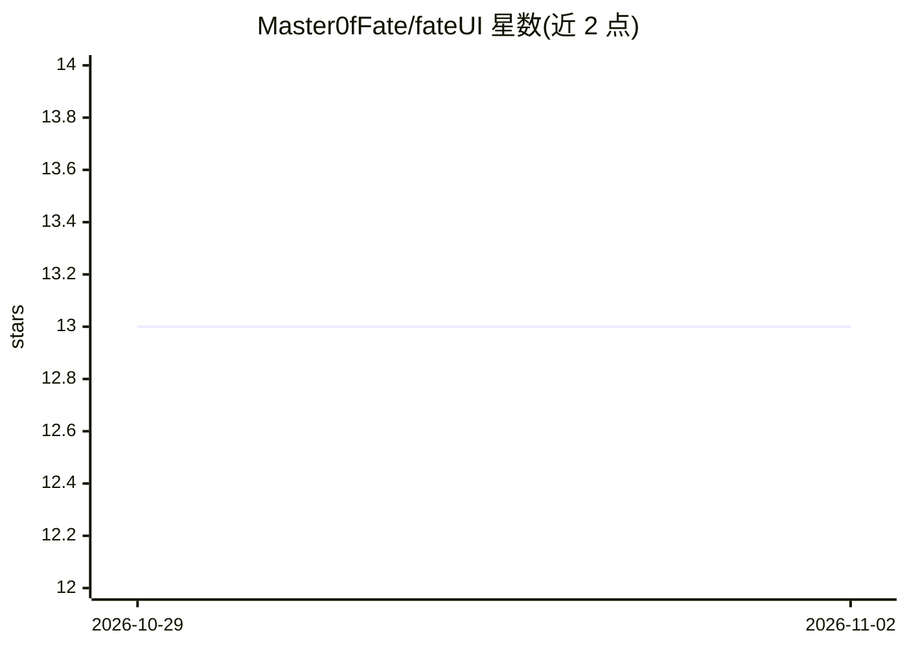

# Master0fFate/fateUI

⭐ 13 · TypeScript · Apache-2.0 · 推送 2026-10-29 · [GitHub](https://github.com/Master0fFate/fateUI) · [官网](https://github.com/Master0fFate/fateUI/releases/) · 个人维护

**本地优先的 Pi 编码 agent 桌面工作台**

基于 Electron 的桌面应用，为 Pi 编码 agent 提供统一工作区：会话、多 agent 委派与编排、浏览器上下文标注、Monaco diff 与 Git 历史审查、手动终端。内嵌 Pi SDK，无需单独安装 Pi 终端；通过 OAuth 或 API key 接入所选 AI provider。提供四级信任边界、隔离 Git worktree、可选的本地语音转录/图像生成与 computer use 模式；数据本地存储，提示词与所选上下文发送至所配置的 provider。提供三平台安装包（未签名，macOS 未公证），Apache-2.0 许可，独立社区项目。

## 筛选速览

| 维度 | 判定 | 备注 |
|---|---|---|
| AI 角色 | `ai-ecosystem` | LLM/agent 周边工具 |
| 许可风险 | `permissive` | Apache-2.0 |
| 部署形态 | `desktop` | 安装包/桌面程序 |
| 模型依赖 | — | README 未给出锁定关系 |
| 硬件要求 | — | 无带数字的原话,不猜 |
| 安装摩擦 | `low` | 无编译、无系统依赖或容器化 |
| 成熟度 | `idea` | |

## 能力要点

- 内嵌 Pi SDK，复用 Pi 终端的会话、技能与全局扩展
- 依赖式多 agent 编排，按 agent 配置模型、推理力度与工具
- 四级信任边界与隔离 Git worktree，集成前需显式审查
- 浏览器页面元素选择并附注到会话，支持本地语音转录与记忆学习

## 适用场景

- 在统一桌面工作区里运行并审查编码 agent 的改动
- 把目标拆成队列与多 agent 工作流并跟踪完成证据
- 通过 SSH/浏览器连接远端 Node companion 在代码所在机器上运行 agent

## 场景标签

`编码 Agent` `多智能体` · 领域:Agent 开发

## 证据(README 行号)

> L7: A local-first desktop workspace for the real Pi coding agent.

## 星数曲线

2026-10-29 13 → 2026-11-02 13（+0）

---
*卡片 v1 · prompt 1.4 · 生成 2026-10-31 · 置信度 high · 依据 README sha `38e1e3e803ed` · [字段定义](../../DATASET.md)*
