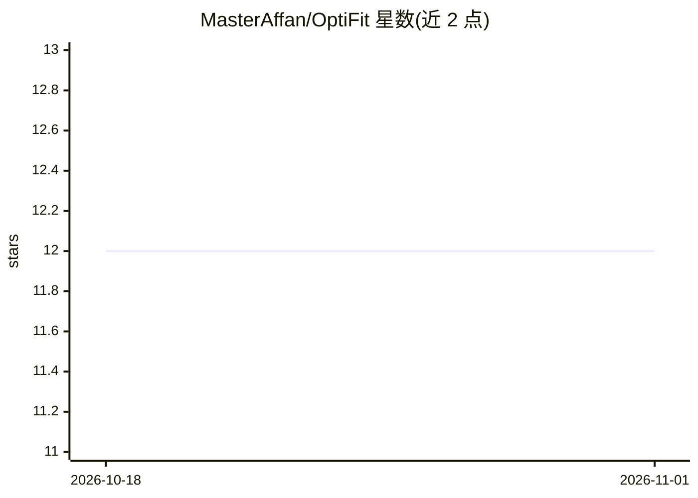

# MasterAffan/OptiFit

⭐ 12 · Dart · NOASSERTION · 推送 2025-11-24 · [GitHub](https://github.com/MasterAffan/OptiFit) · [官网](https://deepwiki.com/MasterAffan/OptiFit) · 组织维护

**AI 健身应用：视频分析动作姿态并提供 AI 健身对话**

由 Flutter 移动端与 Python Flask 后端组成的单体仓库应用：后端进行视频处理与 AI 分析，对深蹲动作提供实时姿态反馈（更多动作在开发中），并含 AI 聊天助手提供健身建议、训练计划与营养指导，支持进度统计与图表追踪。另含 Node.js WebRTC 信令服务器（express/socket.io，默认端口 3000）用于多人视频训练房间。个性化 AI 训练计划标注为即将推出。

## 筛选速览

| 维度 | 判定 | 备注 |
|---|---|---|
| AI 角色 | `ai-native` | 本体是模型或模型工具 |
| 许可风险 | `none` | NOASSERTION |
| 部署形态 | `library` | 以包/库形式分发 |
| 模型依赖 | — | README 未给出锁定关系 |
| 硬件要求 | — | 无带数字的原话,不猜 |
| 安装摩擦 | `low` | 无编译、无系统依赖或容器化 |
| 成熟度 | — | 结构信号不足 |

## 能力要点

- 视频实时分析深蹲动作姿态并即时反馈
- AI 聊天助手提供健身建议、训练与营养指导
- 进度统计与图表追踪
- WebRTC 信令服务器支持多人视频训练房间

## 适用场景

- 训练时通过手机摄像头获得动作姿态纠正
- 向 AI 助手咨询健身计划与营养问题
- 查看长期训练进度统计

## 场景标签

`AI 助手` `图像视频处理` · 领域:对话与助手

## 证据(README 行号)

> L15: OptiFit is an innovative mobile application designed to revolutionize your workout experience. Using the power of A
> L19: - ✅ **Real-Time Form Analysis:** Get instant feedback on your squat form, with more exercises to come.

## 星数曲线

2026-10-18 12 → 2026-11-01 12（+0）

---
*卡片 v1 · prompt 1.4 · 生成 2026-11-01 · 置信度 mid · 依据 README sha `4b719c5594f9` · [字段定义](../../DATASET.md)*
