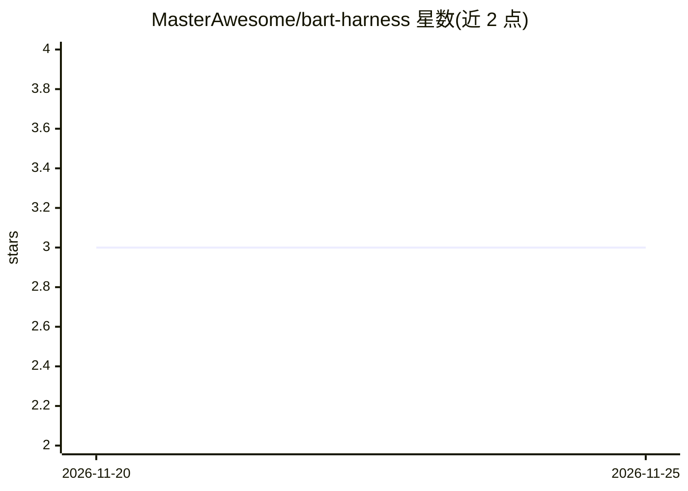

# MasterAwesome/bart-harness

⭐ 3 · Rust · Apache-2.0 · 推送 2026-11-21 · [GitHub](https://github.com/MasterAwesome/bart-harness) · 个人维护

**给开发者的终端编码 agent：持久 Python 会话驱动，自带模型接入**

Rust 编写的终端编码工具，围绕单个持久 Python 解释器运行：文件读取、编辑、命令执行与验证共享同一会话，减少每步工具调用的模型轮次。支持 ChatGPT/Claude Code 订阅、OpenAI/Anthropic/Gemini/OpenRouter 等 API 端点及本地模型服务器，支持 MCP 工具调用、AGENTS.md 项目约定、/rewind 回滚与 bubblewrap 沙箱。无遥测，MIT 或 Apache-2.0 双许可，需 Python 3.10+ 与 Bash，Linux/macOS 可用。

## 筛选速览

| 维度 | 判定 | 备注 |
|---|---|---|
| AI 角色 | `ai-ecosystem` | LLM/agent 周边工具 |
| 许可风险 | `permissive` | Apache-2.0 |
| 部署形态 | `library` | 以包/库形式分发 |
| 模型依赖 | — | README 未给出锁定关系 |
| 硬件要求 | — | 无带数字的原话,不猜 |
| 安装摩擦 | `low` | 无编译、无系统依赖或容器化 |
| 成熟度 | — | 结构信号不足 |

## 能力要点

- 持久 Python 会话：导入、变量与句柄跨步骤复用
- MCP 工具惰性发现，在 Python 内通过 mcp.tools() 查询
- Ctrl+O 检查每步代码/输出，/rewind 回滚对话状态
- --approval 审批模式与 --jail 沙箱隔离

## 适用场景

- 在终端中让 agent 读取、编辑代码并运行验证
- 通过 MCP 接入自有工具服务并在会话中调用
- CI/脚本中以 headless 模式（-p/--json）运行编码任务
- 使用本地模型端点运行编码 agent

## 场景标签

`编码 Agent` · 领域:编码与开发

## 证据(README 行号)

> L5: A terminal coding harness built in Rust around a single persistent Python interpreter. Multi-step file reads, target
> L43: Use an existing **ChatGPT** or **Claude Code** subscription, an API provider, or a local model server:
> L61: Switch models with `/model`, adjust reasoning effort with `/effort` (**Alt+=** / **Alt+-** while typing), and list 

## 星数曲线

2026-11-20 3 → 2026-11-25 3（+0）

---
*卡片 v1 · prompt 1.4 · 生成 2026-11-22 · 置信度 high · 依据 README sha `96be48c58d2f` · [字段定义](../../DATASET.md)*
