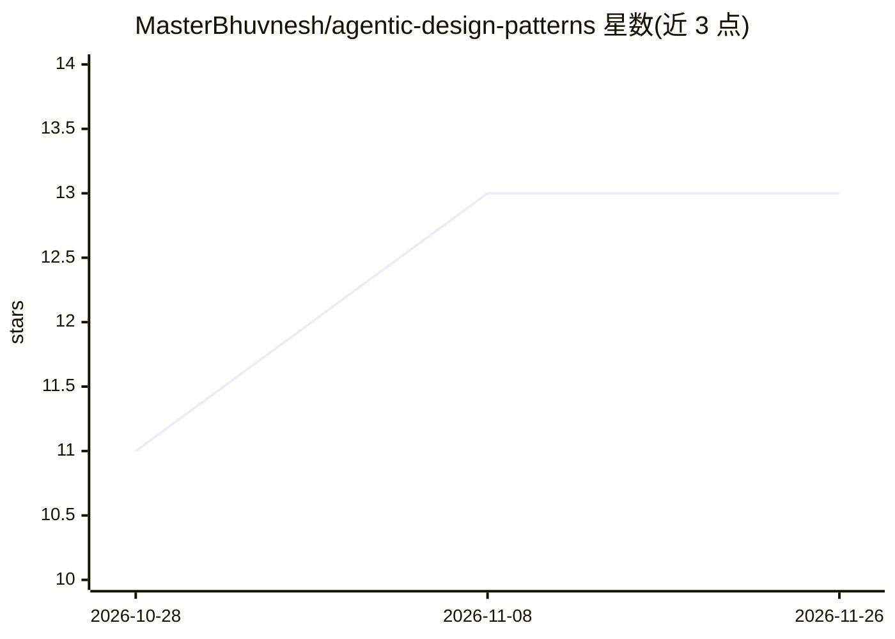

# MasterBhuvnesh/agentic-design-patterns

⭐ 13 · Python · MIT · 推送 2026-08-15 · [GitHub](https://github.com/MasterBhuvnesh/agentic-design-patterns) · 个人维护

**面向 agent 开发者的 21 种 agentic 设计模式教程文档**

以文档为主的教程仓库，将 21 种 agentic AI 设计模式按核心/高级/系统/优化/战略五组组织，每种模式提供四种形态：Mermaid 图、文字讨论（适用场景与利弊）、ASCII 图和可运行的 LangChain 代码示例。每个示例附真实运行结果文件，其中刻意保留失败、不收敛或成本超支的记录并附分析。代码示例通过 NVIDIA NIM 端点调用 LLM，需要 API key；MIT 许可。

## 筛选速览

| 维度 | 判定 | 备注 |
|---|---|---|
| AI 角色 | `ai-knowledge` | 知识聚合/清单类 |
| 许可风险 | `permissive` | MIT |
| 部署形态 | `library` | 以包/库形式分发 |
| 模型依赖 | — | README 未给出锁定关系 |
| 硬件要求 | — | 无带数字的原话,不猜 |
| 安装摩擦 | `low` | 无编译、无系统依赖或容器化 |
| 成熟度 | — | 结构信号不足 |

## 能力要点

- 21 种模式以 Mermaid 图、ASCII 图、讨论文档、可运行代码四种形式文档化
- 每个模式附带真实捕获的运行结果文件
- 保留并分析失败、不收敛、成本超支的运行记录
- 代码示例基于 LangChain，通过 NVIDIA NIM 端点调用

## 适用场景

- 学习 agent 系统的设计模式并查看可运行实现
- 为团队搭建 agent 架构时参考模式的适用场景与取舍
- 复制示例代码在自己的 API key 环境中复现运行

## 场景标签

`教程课程` · 领域:学习与行业

## 证据(README 行号)

> L3: **21 essential patterns for building agentic AI systems.** Each one comes with a diagram, a written discussion, a ru
> L15: Every pattern is documented four ways, so you can pick whichever gets the idea across fastest.
> L22: |**Runnable Code**|`/code`|Actually seeing it work, plus a saved run for every pattern|

## 星数曲线

2026-10-28 11 → 2026-11-26 13（+2）

---
*卡片 v1 · prompt 1.4 · 生成 2026-11-18 · 置信度 high · 依据 README sha `462c96050b94` · [字段定义](../../DATASET.md)*
