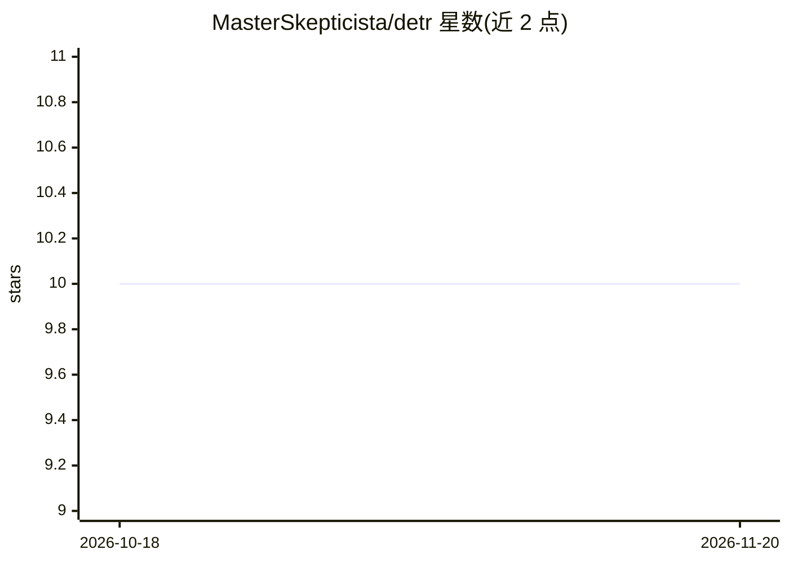

# MasterSkepticista/detr

⭐ 10 · Python · MIT · 推送 2026-07-15 · [GitHub](https://github.com/MasterSkepticista/detr) · 个人维护

**给 CV 研究者的 DETR 检测模型 JAX/Flax 实现**

DETR 端到端目标检测模型的 JAX 与 Flax 最小实现，提供训练与评估流程：支持 Flash Attention、Sinkhorn 求解器、辅助输出的并行二分图匹配，以及 BiT-S ResNet-50 骨干。安装需 git clone 源码并 pip 装依赖，数据采用 TFDS 格式的 MS-COCO；默认配置在 8x A6000 上训练约 4.5 天，README 附带各检查点的 AP 指标表。

## 筛选速览

| 维度 | 判定 | 备注 |
|---|---|---|
| AI 角色 | `ai-native` | 本体是模型或模型工具 |
| 许可风险 | `permissive` | MIT |
| 部署形态 | `library` | 以包/库形式分发 |
| 模型依赖 | — | README 未给出锁定关系 |
| 硬件要求 | — | 无带数字的原话,不猜 |
| 安装摩擦 | `low` | 无编译、无系统依赖或容器化 |
| 成熟度 | — | 结构信号不足 |

## 能力要点

- 支持 Flash Attention 与 Sinkhorn 求解器的 DETR JAX/Flax 实现
- 辅助输出并行二分图匹配（Hungarian matcher）加速训练
- 支持 BiT-S ResNet-50 骨干，提供预训练检查点下载与评估流程

## 适用场景

- 在 JAX/Flax 生态中训练 DETR 目标检测模型
- 加载预训练检查点在 MS-COCO 上评估检测指标
- 复现或扩展 DETR 的匹配与注意力优化

## 场景标签

`目标检测` · 领域:感知与多模态

## 证据(README 行号)

> L3: This is a minimal implementation of DETR using `jax` and `flax`.
> L12: * Supports Flash Attention (up to 50% faster over and above the following optimizations).
> L55: # ~4.5 days on 8x A6000.

## 星数曲线

2026-10-18 10 → 2026-11-20 10（+0）

---
*卡片 v1 · prompt 1.4 · 生成 2026-11-20 · 置信度 high · 依据 README sha `d6b7626c167f` · [字段定义](../../DATASET.md)*
