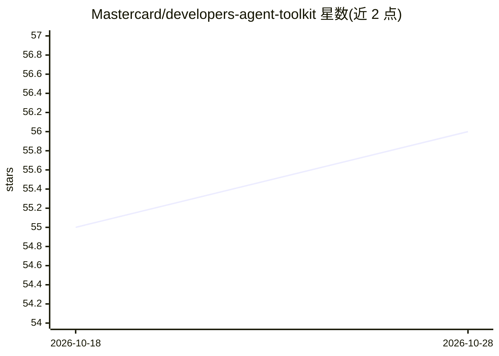

# Mastercard/developers-agent-toolkit

⭐ 57 · TypeScript · MIT · 推送 2026-10-01 · [GitHub](https://github.com/Mastercard/developers-agent-toolkit) · [官网](https://developer.mastercard.com) · 组织维护

**让 agent 通过 MCP 发现并读取 Mastercard 开发者平台的服务与文档**

Mastercard 官方维护的 agent 工具包：提供一个基于 Model Context Protocol（MCP）的服务器与 TypeScript/JavaScript 库，暴露 get-services-list、get-documentation、get-api-operation-list 等工具，供 agent 查询 Mastercard Developers 平台的产品列表、API 操作明细与 OAuth 1.0a/2.0、Open Finance 集成指南。支持 npx 直接运行、npm 安装为库，并为 Claude Code、Codex、Cursor 提供捆绑 mastercard-best-practices 技能的官方插件。要求 Node 18+，MIT 许可。

## 筛选速览

| 维度 | 判定 | 备注 |
|---|---|---|
| AI 角色 | `ai-ecosystem` | LLM/agent 周边工具 |
| 许可风险 | `permissive` | MIT |
| 部署形态 | `library` | 以包/库形式分发 |
| 模型依赖 | locked-api |  |
| 硬件要求 | — | 无带数字的原话,不猜 |
| 安装摩擦 | `low` | 无编译、无系统依赖或容器化 |
| 成熟度 | — | 结构信号不足 |

## 能力要点

- MCP 服务器提供 9 个工具：服务发现、文档读取、API 操作查询、集成指南获取
- 可作为独立服务器（npx）运行或以库形式集成进 TypeScript/JavaScript 项目
- 为 Claude Code、Codex、Cursor 提供官方插件（含 mastercard-best-practices 技能）
- skills/ 目录为技能单一来源，附带 sync.js 同步与校验脚本

## 适用场景

- 让 Claude/Codex/Cursor 等 agent 直接查询 Mastercard API 文档与操作明细
- 通过自然语言让 agent 完成 OAuth 1.0a/2.0 认证集成
- 在 TypeScript 项目中以库形式接入 Mastercard 开发者平台能力

## 场景标签

 · 领域:开发者工具/金融 API 集成

## 证据(README 行号)

> L5: The Mastercard Developers Agent Toolkit allows popular agent frameworks (currently Model Context Protocol - MCP) to 
> L12: * **MCP-Based**: Built on the Model Context Protocol (MCP) for standardized communication.
> L38: We provide a standalone Model Context Protocol (MCP) server that can be used with MCP clients.

## 星数曲线

2026-10-18 55 → 2026-10-28 56（+1）

---
*卡片 v1 · prompt 1.4 · 生成 2026-10-24 · 置信度 high · 依据 README sha `bc33fe3475ab` · [字段定义](../../DATASET.md)*
