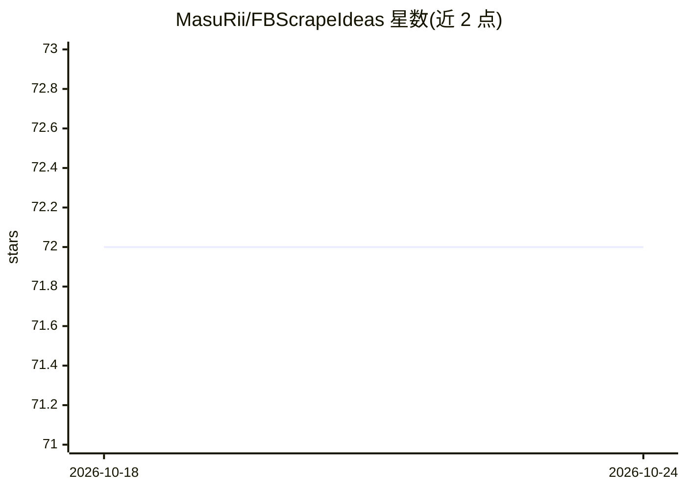

# MasuRii/FBScrapeIdeas

⭐ 72 · Python · MIT · 推送 2025-12-30 · [GitHub](https://github.com/MasuRii/FBScrapeIdeas) · 个人维护

**登录抓取 Facebook 群组帖子并做 AI 分类分析的 CLI 工具**

基于 Selenium 的 Facebook 群组抓取 CLI：登录后采集公开/私有群组的帖子与评论（内容、URL、时间戳、作者等字段），存入本地 SQLite。抓取结果可交由 AI 处理，生成分类、子分类、关键词、摘要、潜在课题标记与评论情感分析。AI 提供方支持 Google Gemini（默认）及 OpenAI 兼容端点（OpenAI、Ollama、LM Studio、OpenRouter 等），提示词可通过 JSON 自定义。提供预编译二进制与源码两种运行方式，数据可导出 CSV/JSON。README 声明仅供教育用途，抓取可能违反 Facebook 服务条款。

## 筛选速览

| 维度 | 判定 | 备注 |
|---|---|---|
| AI 角色 | `ai-enhanced` | 去掉 AI 部分产品仍成立 |
| 许可风险 | `permissive` | MIT |
| 部署形态 | `desktop` | 安装包/桌面程序 |
| 模型依赖 | local-ok | 支持本地模型 |
| 硬件要求 | — | 无带数字的原话,不猜 |
| 安装摩擦 | `low` | 无编译、无系统依赖或容器化 |
| 成熟度 | — | 结构信号不足 |

## 能力要点

- 登录态抓取 Facebook 群组帖子与评论，存入本地 SQLite
- AI 分类生成类别、关键词、摘要、潜在课题标记与评论情感分析
- 支持 Gemini 默认与 OpenAI 兼容端点（Ollama/LM Studio/OpenRouter/Groq 等）
- CLI 提供 scrape/process-ai/view/export/stats 命令与 CSV/JSON 导出

## 适用场景

- 从大学 Facebook 群组讨论中挖掘毕业设计或论文课题想法
- 批量采集群组帖子评论并做本地 AI 分类与情感分析
- 对抓取数据做筛选浏览、统计与导出

## 场景标签

`网页抓取` · 领域:效率与自动化

## 证据(README 行号)

> L10: A CLI-driven application to scrape and analyze Facebook group posts for insights using Selenium and Google Gemini A
> L12: This tool helps users identify potential capstone/thesis ideas, student problems, or other valuable insights from u
> L60: ### 🔍 AI Analysis Fields
> L66: - Sentiment analysis (for comments)

## 星数曲线

2026-10-18 72 → 2026-10-24 72（+0）

---
*卡片 v1 · prompt 1.4 · 生成 2026-10-24 · 置信度 mid · 依据 README sha `1cd3f8fb8ff0` · [字段定义](../../DATASET.md)*
