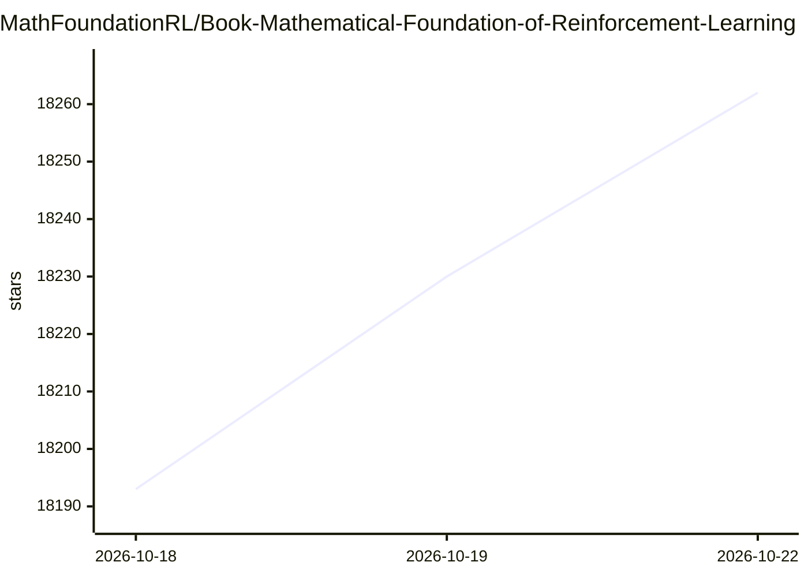

# MathFoundationRL/Book-Mathematical-Foundation-of-Reinforcement-Learning

⭐ 18,270 · MATLAB · 推送 2026-10-20 · [GitHub](https://github.com/MathFoundationRL/Book-Mathematical-Foundation-of-Reinforcement-Learning) · 组织维护 · 中文 README

**给强化学习学习者提供数学基础教材及配套课程资源**

《Mathematical Foundations of Reinforcement Learning》一书的主页仓库，提供 Latex/Beamer 制作的幻灯片源码获取方式、全书章节目录、读者对象说明与引用格式。作者自 2019 年起在研究生课程中编写讲义成书，由 Springer 与清华大学出版社出版。仓库还汇总了读者制作的 Python/Matlab/R/C++ 代码实现与多语言学习笔记，并提供中英文课程视频链接；教授可邮件索取幻灯片源码用于授课。PDF 文件托管于 GitHub，另附印刷版勘误表。

## 筛选速览

| 维度 | 判定 | 备注 |
|---|---|---|
| AI 角色 | `ai-knowledge` | 知识聚合/清单类 |
| 许可风险 | `none` | — |
| 部署形态 | `None` |  |
| 模型依赖 | — | README 未给出锁定关系 |
| 硬件要求 | — | 无带数字的原话,不猜 |
| 安装摩擦 | `low` | 无编译、无系统依赖或容器化 |
| 成熟度 | — | 结构信号不足 |

## 动量与使用信号

- 维护:`active` — 距上次 push 5.1 天,年发版 0,2 位贡献者
- 涨星:近 1 天 **+17**(自 20261016 起算)

## 能力要点

- 以数学视角系统介绍强化学习基本概念、问题与经典算法（共 10 讲）
- 配套中英文课程视频（Bilibili/YouTube），累计播放超 210 万次
- 汇总读者贡献的多语言代码实现与学习笔记链接
- 全部示例基于 grid world 任务展开

## 适用场景

- 零基础系统学习强化学习的数学原理
- 高年级本科生或研究生配合课程视频自学
- 教师备课借鉴课程内容与幻灯片
- 查找本书配套的第三方代码实现与学习笔记

## 场景标签

`教程课程` `强化学习` · 领域:学习与行业

## 证据(README 行号)

> L9: This book aims to provide a **mathematical but friendly** introduction to the fundamental concepts, basic problems, 
> L27: This book is designed for senior undergraduate students, graduate students, researchers, and practitioners interest
> L36: I have been teaching a graduate-level course on reinforcement learning since 2019. Along with teaching, I have been

## 星数曲线

2026-10-18 18,193 → 2026-10-22 18,262（+69）

---
*卡片 v1 · prompt 1.4 · 生成 2026-10-18 · 置信度 high · 依据 README sha `3b46cf00e2ea` · [字段定义](../../DATASET.md)*
