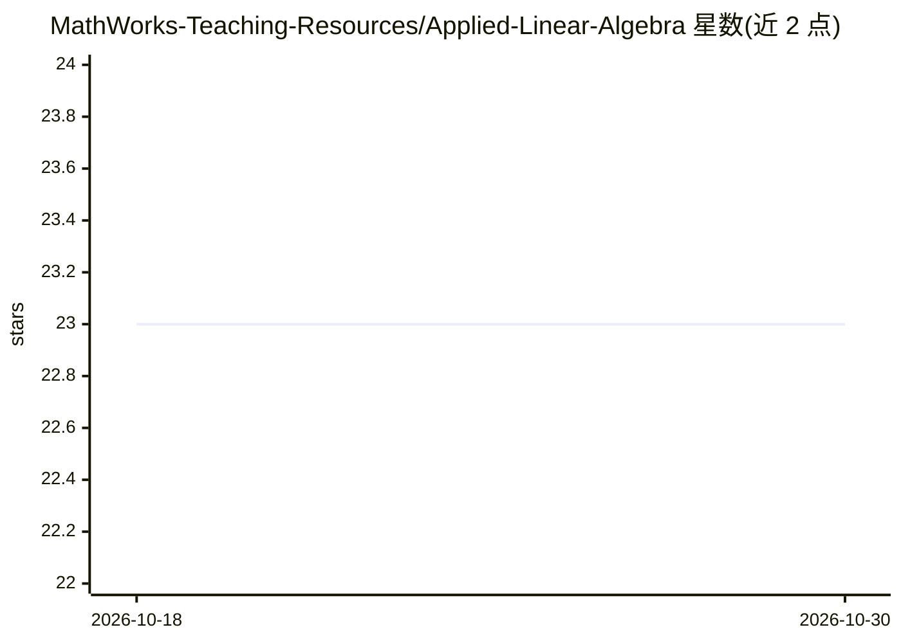

# MathWorks-Teaching-Resources/Applied-Linear-Algebra

⭐ 23 · MATLAB · BSD-3-Clause · 推送 2026-05-07 · [GitHub](https://github.com/MathWorks-Teaching-Resources/Applied-Linear-Algebra) · 组织维护

**MATLAB 线性代数教学模块：以化学、隐写、力学与机器学习应用教学**

MathWorks 教学团队制作的线性代数课程模块，由多个交互式 MATLAB live script 组成，覆盖向量与矩阵运算、矩阵方程求解、零空间、特征值与特征向量，并通过配平化学反应、静力分析、图像加密、马尔可夫建模（僵尸爆发/蜉蝣/HIV）、手写数字识别与机械臂等应用场景组织教学。需 MATLAB R2024a 及以上，可经 MATLAB Online 使用，或在桌面端克隆仓库后打开 AppliedLinAlg.prj 加载；部分脚本依赖 Symbolic Math Toolbox、Image Processing Toolbox、Statistics and Machine Learning Toolbox、Deep Learning Toolbox。

## 筛选速览

| 维度 | 判定 | 备注 |
|---|---|---|
| AI 角色 | `ai-knowledge` | 知识聚合/清单类 |
| 许可风险 | `permissive` | BSD-3-Clause |
| 部署形态 | `None` |  |
| 模型依赖 | — | README 未给出锁定关系 |
| 硬件要求 | — | 无带数字的原话,不猜 |
| 安装摩擦 | `low` | 无编译、无系统依赖或容器化 |
| 成熟度 | — | 结构信号不足 |

## 能力要点

- 以 7 组应用场景（化学配平、隐写术、静力、马尔可夫建模、数字识别、机器人学）组织线性代数内容
- 交互式 live script 可分段运行，适用于课堂演示与课后练习
- 兼容 MATLAB R2024a 及以上版本，支持 MATLAB Online 与桌面端两种获取方式
- 手写数字识别脚本包含 SVD、形态学预处理与可解释机器学习内容

## 适用场景

- 线性代数第一门课的课堂演示与互动作业
- 用跨学科应用（化学/工程/机器学习）巩固线性代数概念
- 自学 MATLAB 中矩阵方法的学生按脚本分段练习

## 场景标签

`教程课程` · 领域:学习与行业

## 证据(README 行号)

> L9: **Curriculum Module**
> L15: This curriculum module contains interactive MATLAB® live scripts that apply fundamental concepts and basic terminol
> L19: You can use this live script as demonstrations in lectures, class activities, or interactive assignments outside cl

## 星数曲线

2026-10-18 23 → 2026-10-30 23（+0）

---
*卡片 v1 · prompt 1.4 · 生成 2026-10-27 · 置信度 high · 依据 README sha `8aac7b0526f6` · [字段定义](../../DATASET.md)*
