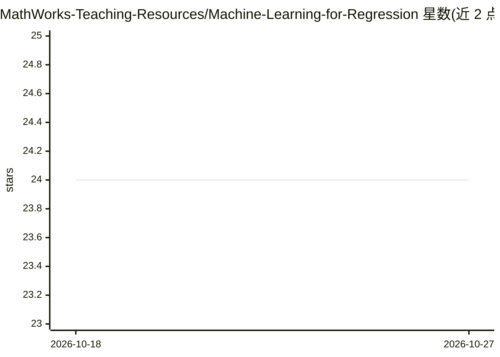

# MathWorks-Teaching-Resources/Machine-Learning-for-Regression

⭐ 24 · MATLAB · BSD-3-Clause · 推送 2026-09-25 · [GitHub](https://github.com/MathWorks-Teaching-Resources/Machine-Learning-for-Regression) · 组织维护

**MATLAB 交互式回归机器学习教学模块（4 个 live script）**

MathWorks 教学资源库的课程模块，含 4 个交互式 MATLAB live script，讲授机器学习回归工作流：基线线性回归与交叉验证、特征工程与正则化（Lasso/Ridge）、回归树与集成方法、优化与梯度下降。面向无机器学习基础的教师与学生，可用作课堂演示、课内活动或课后作业。可在 MATLAB Online 打开，或桌面端克隆仓库后打开 MLforRegression.prj；依赖 Statistics and Machine Learning Toolbox 与 System Identification Toolbox，兼容 R2026a 及以上版本。

## 筛选速览

| 维度 | 判定 | 备注 |
|---|---|---|
| AI 角色 | `ai-knowledge` | 知识聚合/清单类 |
| 许可风险 | `permissive` | BSD-3-Clause |
| 部署形态 | `None` |  |
| 模型依赖 | — | README 未给出锁定关系 |
| 硬件要求 | — | 无带数字的原话,不猜 |
| 安装摩擦 | `low` | 无编译、无系统依赖或容器化 |
| 成熟度 | — | 结构信号不足 |

## 能力要点

- 4 个 live script 覆盖基线建模到梯度下降的回归工作流
- 支持 MATLAB Online 与桌面端（打开 .prj 工程文件）两种使用方式
- 不要求学生具备机器学习先修知识
- 内含分节练习引导，Live Editor 中可逐节运行

## 适用场景

- 课堂上演示回归建模与模型比较过程
- 作为学生课后交互式作业或课内活动
- 自学机器学习回归的基础工作流

## 场景标签

`教程课程` · 领域:学习与行业

## 证据(README 行号)

> L7: **Curriculum Module**
> L13: This curriculum module contains interactive MATLAB® live scripts that introduce machine learning for regression thr
> L19: You can use these live scripts as lecture demonstrations, in\-class activities, or interactive assignments outside 

## 星数曲线

2026-10-18 24 → 2026-10-27 24（+0）

---
*卡片 v1 · prompt 1.4 · 生成 2026-10-27 · 置信度 high · 依据 README sha `0adc41c92c67` · [字段定义](../../DATASET.md)*
