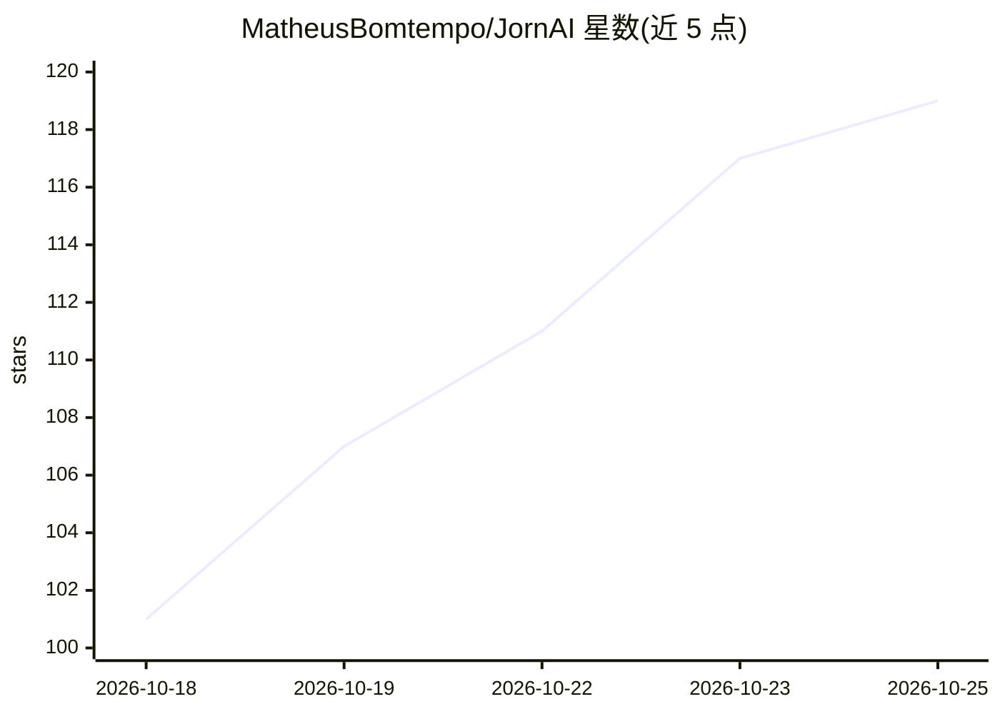

# MatheusBomtempo/JornAI

⭐ 125 · TypeScript · MIT · 推送 2026-10-04 · [GitHub](https://github.com/MatheusBomtempo/JornAI) · [官网](https://jorn-ia.vercel.app/about) · 个人维护

**新闻编辑室的 AI 辅助 Instagram 发文工具，人工终审**

面向新闻编辑室的开源 Web 应用（Next.js + TypeScript + PostgreSQL/Prisma）：粘贴新闻稿、公文或链接，AI 生成标题、副标题与说明文字，经人工审阅后发布到 Instagram（单图、最多 10 图轮播、Reels 视频、可选限时动态）。内置事实准确性管线：来源文本先经确定性清洗与个人数据脱敏，生成后由确定性校验器核对，违规触发一次修正重生成；AI 仅写文字，不生成或选择图片。支持多租户、三种角色与同侪审批，AI_PROVIDER 可配置为 mock 无密钥运行。明确不做排期、AI 生图与免人工审批发布。

## 筛选速览

| 维度 | 判定 | 备注 |
|---|---|---|
| AI 角色 | `ai-native` | 本体是模型或模型工具 |
| 许可风险 | `permissive` | MIT |
| 部署形态 | `library` | 以包/库形式分发 |
| 模型依赖 | locked-api |  |
| 硬件要求 | — | 无带数字的原话,不猜 |
| 安装摩擦 | `medium` | 含编译或系统依赖之一 |
| 成熟度 | — | 结构信号不足 |

## 能力要点

- AI 生成文案 + 人工强制审批的发布流程，每次改动留版本历史
- 事实优先管线：确定性清洗、个人数据脱敏、生成后确定性校验
- 图片编辑器（模糊人脸/车牌、模糊边框、调色）与视频 9:16 归一化、动态标题卡
- 多语言包机制（en/pt），AI_PROVIDER=mock 可无外部服务体验全流程

## 适用场景

- 突发事件（事故、天气预警）时快速产出品牌一致的 Instagram 短帖
- 新闻编辑室在发布前对 AI 文案做事实核验与人工审批
- 多公司/多角色协作的编辑室内容生产管理

## 场景标签

`AI 写作` · 领域:内容生成

## 证据(README 行号)

> L5: An open-source web tool that lets a newsroom publish breaking-news posts to Instagram with almost no friction: paste
> L23: > **TL;DR:** paste a text, an article link or a PDF, optionally credit someone (📸 `@photographer`), and hit **Gener

## 星数曲线

2026-10-18 101 → 2026-10-25 119（+18）

---
*卡片 v1 · prompt 1.4 · 生成 2026-10-23 · 置信度 high · 依据 README sha `836899aa04fd` · [字段定义](../../DATASET.md)*
