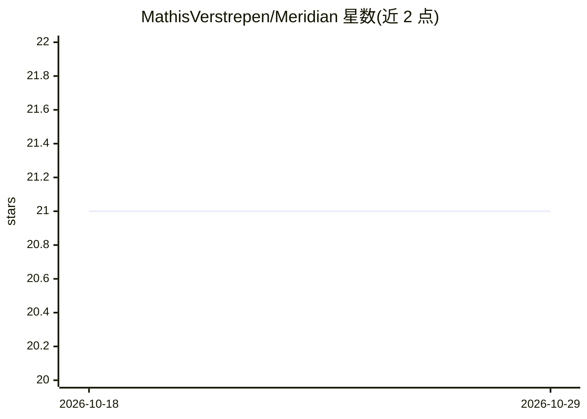

# MathisVerstrepen/Meridian

⭐ 21 · Python · MIT · 推送 2026-10-25 · [GitHub](https://github.com/MathisVerstrepen/Meridian) · [官网](https://app.meridianchat.com) · 个人维护

**图结构可视化构建与运行 AI 对话工作流的开源平台**

基于 Nuxt 4 与 Python/FastAPI 的开源平台：以可视化画布替代线性聊天，将 LLM、输入源（文本/附件/GitHub/GitLab）、工具与逻辑块连接为图。生成节点支持 Text-to-Text 调用、多模型并行加聚合、条件路由；含沙箱化 Python 代码执行、Mermaid 图生成、Prompt 优化工作流。模型后端经 OpenRouter.ai 接入多家模型；数据层用 PostgreSQL/Neo4j/Redis。生产部署依赖 Docker Compose 与预构建镜像，须配置 secrets 文件后启动。

## 筛选速览

| 维度 | 判定 | 备注 |
|---|---|---|
| AI 角色 | `ai-native` | 本体是模型或模型工具 |
| 许可风险 | `permissive` | MIT |
| 部署形态 | `self-host` | docker 或自建部署 |
| 模型依赖 | locked-api |  |
| 硬件要求 | — | 无带数字的原话,不猜 |
| 安装摩擦 | `low` | 无编译、无系统依赖或容器化 |
| 成熟度 | — | 结构信号不足 |

## 能力要点

- 可视化图画布构建 AI 工作流，支持分支对话与子图执行
- 并行多模型查询并由聚合模型合成单一回答
- 沙箱化（Docker+NSJail）Python 代码执行，产物内嵌聊天
- 经 OpenRouter.ai 接入多家模型，含成本与 token 用量追踪

## 适用场景

- 以图结构搭建并运行分支式多模型对话工作流
- 把 GitHub/GitLab 仓库代码作为对话上下文
- 在平台内做 Prompt 质量审计与定向重写

## 场景标签

`工作流自动化` `聊天机器人` `提示工程` · 领域:Agent 开发

## 证据(README 行号)

> L14: Meridian is an open-source, graph-based platform for building, visualizing, and interacting with complex AI workflo
> L33:  * `Parallelization`: Executes a prompt against multiple LLMs simultaneously and uses an aggregator model to synthe
> L66:  * Powered by **OpenRouter.ai**, providing access to a vast array of proprietary and open-source models (from OpenA

## 星数曲线

2026-10-18 21 → 2026-10-29 21（+0）

---
*卡片 v1 · prompt 1.4 · 生成 2026-10-28 · 置信度 high · 依据 README sha `19af400686f4` · [字段定义](../../DATASET.md)*
