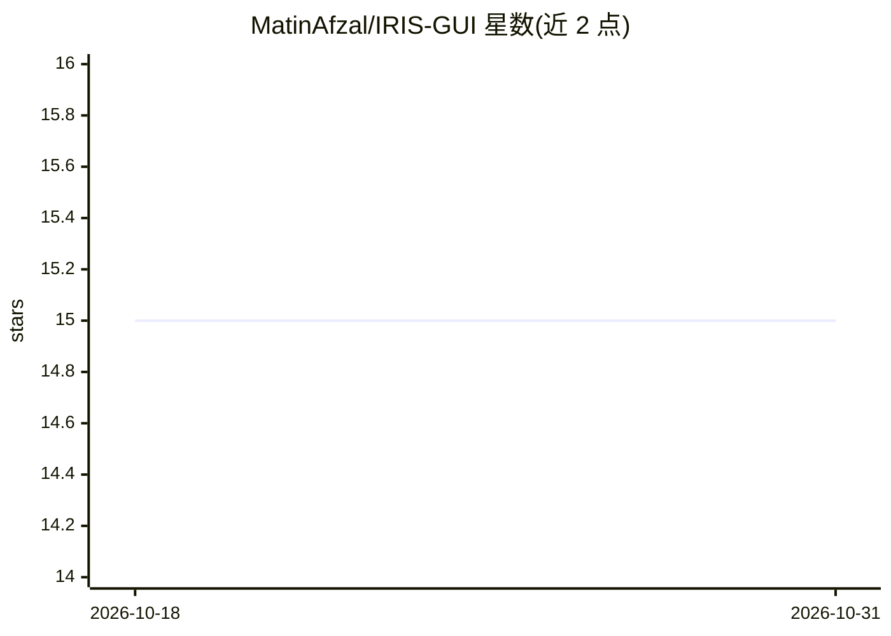

# MatinAfzal/IRIS-GUI

⭐ 15 · Python · MIT · 推送 2026-08-19 · [GitHub](https://github.com/MatinAfzal/IRIS-GUI) · 个人维护

**用 scikit-learn 对鸢尾花数据做分类预测的 tkinter 图形程序**

基于 tkinter 与 scikit-learn 编写的桌面图形程序：用户输入鸢尾花萼片与花瓣的长宽，选择不同的机器学习模型来预测花的种类（Setosa/Versicolour/Virginica 三类）。数据来自经典的 iris 数据集，程序以 Python 源码形式提供，通过 git clone 克隆仓库、pip 安装依赖后运行单个脚本启动，面向希望以图形界面方式体验分类模型的用户。

## 筛选速览

| 维度 | 判定 | 备注 |
|---|---|---|
| AI 角色 | `ai-native` | 本体是模型或模型工具 |
| 许可风险 | `permissive` | MIT |
| 部署形态 | `library` | 以包/库形式分发 |
| 模型依赖 | — | README 未给出锁定关系 |
| 硬件要求 | — | 无带数字的原话,不猜 |
| 安装摩擦 | `low` | 无编译、无系统依赖或容器化 |
| 成熟度 | — | 结构信号不足 |

## 能力要点

- tkinter 图形界面输入萼片/花瓣的长宽数值
- 支持选择不同机器学习模型进行预测
- 基于经典 iris 数据集的三分类（Setosa/Versicolour/Virginica）

## 适用场景

- 通过图形界面体验鸢尾花分类模型
- 学习 scikit-learn 分类算法的演示工具

## 场景标签

 · 领域:机器学习/桌面应用

## 证据(README 行号)

> L2: A graphical machine learning program written with tkinter and scikit-learn library.
> L12: This program receives the length and width of the iris sepal and petal from the user and the user can predict the t

## 星数曲线

2026-10-18 15 → 2026-10-31 15（+0）

---
*卡片 v1 · prompt 1.4 · 生成 2026-10-31 · 置信度 mid · 依据 README sha `dd9cac00cbdd` · [字段定义](../../DATASET.md)*
